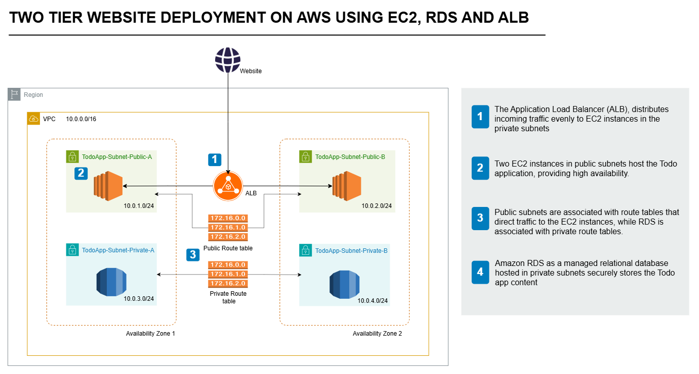
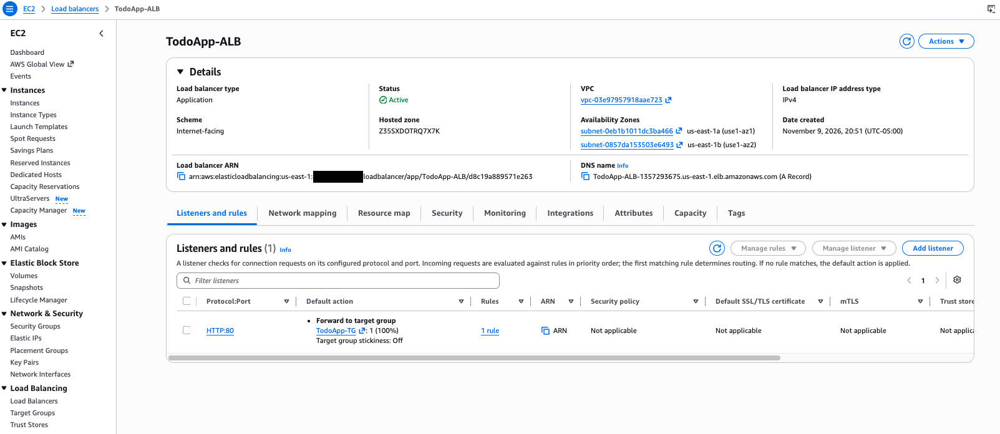

# Two-Tier To-Do App on AWS (EC2, RDS, ALB)

A To-Do List web app deployed on a two-tier AWS architecture. You can add tasks with a due date, mark them complete and delete them.

The Node.js (Express) app runs on **two EC2 instances** in separate Availability Zones. An **Application Load Balancer** spreads traffic across them, and the tasks are stored in an **Amazon RDS for MySQL** database in private subnets.

## Architecture



1. **Application Load Balancer** receives requests from the internet and distributes them evenly across both EC2 instances.
2. **Two EC2 instances**, one in each public subnet (`10.0.1.0/24`, `10.0.2.0/24`), run the Node.js app. If one instance or AZ fails, the other keeps serving traffic.
3. **Route tables**: the public route table sends `0.0.0.0/0` to an Internet Gateway. The private route table has only the local VPC route, so the database is not reachable from the internet.
4. **Amazon RDS (MySQL)** runs in a DB subnet group spanning both private subnets (`10.0.3.0/24`, `10.0.4.0/24`) and stores the tasks.

### Network layout

| Resource | Value |
|---|---|
| VPC | `10.0.0.0/16` |
| TodoApp-Subnet-Public-A (AZ 1) | `10.0.1.0/24` |
| TodoApp-Subnet-Public-B (AZ 2) | `10.0.2.0/24` |
| TodoApp-Subnet-Private-A (AZ 1) | `10.0.3.0/24` |
| TodoApp-Subnet-Private-B (AZ 2) | `10.0.4.0/24` |

> These CIDRs match the architecture diagram.

### Security groups

Each tier accepts traffic only from the tier in front of it.

| Security group | Direction | Rule | Source / destination |
|---|---|---|---|
| `ToDoApp-ALB-SG` | Inbound | HTTP `80` | `0.0.0.0/0` |
| `ToDoApp-ALB-SG` | Outbound | TCP `3000` | `ToDoApp-Webserver-SG` |
| `ToDoApp-Webserver-SG` | Inbound | TCP `3000` | `ToDoApp-ALB-SG` |
| `ToDoApp-Webserver-SG` | Inbound | SSH `22` | My IP (`x.x.x.x/32`) |
| `ToDoApp-Webserver-SG` | Outbound | All traffic | `0.0.0.0/0` (RDS, package installs, Session Manager) |
| `ToDoApp-Database-SG` | Inbound | MySQL `3306` | `ToDoApp-Webserver-SG` |

Why each rule exists, inbound and outbound, is explained in [docs/setup-network.md → How the rules fit together](docs/setup-network.md#how-the-rules-fit-together).

You can reach the instances over SSH from your own IP only, or through **Session Manager** using the instances' IAM role (`AmazonSSMManagedInstanceCore`), which needs no open port.

## Project structure

```
.
├── index.js            # Express API + static file server (port 3000)
├── public/             # Frontend (index.html, script.js, style.css)
├── db/
│   └── schema.sql      # Creates the todo_app database and Tasks table
├── .env.example        # Environment variables the app reads
└── docs/
    ├── architecture.png
    ├── setup-network.md  # VPC, subnets, route tables, security groups
    ├── setup-rds.md      # DB subnet group, RDS MySQL instance
    ├── setup-ec2.md      # IAM role, EC2 instances, .env, schema, running the app
    ├── setup-alb.md      # Target group, ALB, testing failover
    ├── teardown.md       # Deleting every lab resource, in order
    ├── troubleshooting.md  # Every issue hit during deployment + fixes
    ├── deployment-progress.md  # Deployment report: IDs, test results, issues, cost
    ├── run-1/            # Archived docs from the first build
    └── images/           # Console and terminal screenshots used in the guides
```

## API

All endpoints return JSON.

| Method | Path | Body | Description |
|---|---|---|---|
| `GET` | `/tasks` | | List all tasks |
| `GET` | `/tasks/:id` | | Get one task (`404` if missing) |
| `POST` | `/tasks` | `{"taskName", "taskDescription"?, "dueDate"?}` | Create a task (`201`) |
| `PUT` | `/tasks/:id` | Any of `taskName`, `taskDescription`, `dueDate`, `completed` | Update a task |
| `DELETE` | `/tasks/:id` | | Delete a task |
| `GET` | `/config` | | Returns `API_BASE_URL` for the frontend |

## Configuration

The app reads these environment variables from `.env` (see [.env.example](.env.example)):

| Variable | Description |
|---|---|
| `DB_HOST` | RDS endpoint |
| `DB_USER` | Database user |
| `DB_PASSWORD` | Database password |
| `DB_NAME` | Database name (`todo_app`) |
| `API_BASE_URL` | URL the browser calls for the API. Set it to `http://<alb-dns-name>` |

> **Important:** if `API_BASE_URL` is unset, the frontend falls back to `http://localhost:3000`, and the page loads through the ALB but shows no tasks.

## Deployment

### Prerequisites

- An AWS account with permissions for VPC, EC2, RDS, ELB and IAM
- This repository on GitHub, which the EC2 instances clone: [masumshamsur/Project-ToDoApp](https://github.com/masumshamsur/Project-ToDoApp)

Build in this order: network, database, web servers, then load balancer. The results are in the [deployment report](docs/deployment-progress.md).

### 1. Create the network

For the full walkthrough, see [docs/setup-network.md](docs/setup-network.md).

1. Create the VPC `10.0.0.0/16` with two public and two private subnets across two AZs (CIDRs in the table above). Enable DNS hostnames, and auto-assign public IPv4 on the public subnets.
2. Attach an Internet Gateway, then route `0.0.0.0/0` to it from the public route table.
3. Leave the private route table with only the local route.
4. Create the three security groups shown above, including the ALB group's outbound rule.

### 2. Create the RDS database

For the full walkthrough, see [docs/setup-rds.md](docs/setup-rds.md).

1. Create a DB subnet group with **only** the two private subnets.
2. Create a **MySQL** instance in that subnet group with `ToDoApp-Database-SG` and **Public access: No**.
3. Copy the endpoint and keep the master password. You can't connect from your computer, because the database is private. The web servers connect to it in the next step.

### 3. Launch the EC2 instances

For the full walkthrough, including the exact commands and the systemd service, see [docs/setup-ec2.md](docs/setup-ec2.md).

1. Create an IAM role for EC2 with `AmazonSSMManagedInstanceCore`.
2. Launch two Amazon Linux 2023 instances, one in each public subnet, with `ToDoApp-Webserver-SG` and the IAM role.
3. On each instance, install Node.js, clone the repo to `~/todo-app`, and create `.env` with the RDS endpoint and password. Then test the database connection.
4. From one instance, create the `todo_app` database and `Tasks` table ([db/schema.sql](db/schema.sql)). The guide does this with a short Node.js script that uses the app's `mysql2` driver, so no MySQL client is needed.
5. Run the app as a systemd service on both instances, and test `/tasks`.

### 4. Create the Application Load Balancer

For the full walkthrough, see [docs/setup-alb.md](docs/setup-alb.md).

1. Create a target group (instances, HTTP `3000`, health check path `/`, VPC `TodoAppVPC`) and register both instances.
2. Create an internet-facing ALB in both public subnets with `ToDoApp-ALB-SG` and a listener on HTTP `80` that forwards to the target group. If it shows **Reachability may be impacted**, the ALB group is missing its outbound rule.
3. Set `API_BASE_URL=http://<alb-dns-name>` in `.env` on both instances and restart the service.
4. Open `http://<alb-dns-name>` in a browser, then test failover by stopping the app on one instance.



### Run locally

With a local MySQL server and `db/schema.sql` loaded:

```bash
cp .env.example .env   # set DB_HOST=localhost and API_BASE_URL=http://localhost:3000
npm install
npm start
```

The app runs at http://localhost:3000.

## Tech stack

| Layer | Technology |
|---|---|
| Frontend | HTML, CSS, vanilla JavaScript |
| Backend | Node.js, Express, mysql2 |
| Compute | Amazon EC2 (Amazon Linux 2023) |
| Load balancing | Application Load Balancer |
| Database | Amazon RDS for MySQL |
| Networking / security | Amazon VPC, security groups, IAM |

## Troubleshooting

[docs/troubleshooting.md](docs/troubleshooting.md) covers every issue hit during this deployment, with screenshots, plus diagnostic commands. The most common ones:

| Symptom | Cause / fix |
|---|---|
| Page loads but the list is empty and the console shows requests to `localhost:3000` | `API_BASE_URL` isn't set on the instance. Set it to the ALB URL and restart the service. |
| `GET /tasks` returns `500` | The app can't reach the database. Check `.env`, and confirm `ToDoApp-Database-SG` allows `3306` from `ToDoApp-Webserver-SG`. Run `journalctl -u todo-app` for the error. |
| `ER_NO_SUCH_TABLE` in logs | `db/schema.sql` hasn't been loaded, or `DB_NAME` doesn't match. |
| ALB returns `502` / `503`, or targets are **unhealthy** | The app isn't running on port `3000`, `ToDoApp-Webserver-SG` doesn't allow `3000` from `ToDoApp-ALB-SG`, or `ToDoApp-ALB-SG` has no outbound rule to `3000`. |
| ALB shows **Reachability may be impacted** | `ToDoApp-ALB-SG` is missing an inbound or outbound rule. Add outbound TCP `3000` → `ToDoApp-Webserver-SG`. |
| ALB URL times out | `ToDoApp-ALB-SG` is missing inbound HTTP `80`, or the ALB isn't in the public subnets. |
| SSH times out | Your public IP changed. Edit the SSH rule in `ToDoApp-Webserver-SG` and select **My IP** again. |
| Instance doesn't show up in Session Manager | The IAM role is missing `AmazonSSMManagedInstanceCore`, or the instance has no public IP. |

## Clean up

Delete resources in this order to avoid dependency errors and ongoing charges: ALB → target group → EC2 instances → RDS instance (skip the final snapshot if you don't need it) → DB subnet group → security groups → VPC. The ALB and web server security groups reference each other, so delete the ALB group's outbound rule first. For the console steps for each resource, see [docs/teardown.md](docs/teardown.md).
