# Set up the EC2 instances

You launch two identical instances, one in each public subnet, and run the app on port `3000` as a systemd service.

## 1. Create the IAM role

1. Open the **IAM** console and go to **Roles → Create role**.
2. **Trusted entity:** AWS service → **EC2**.
3. Attach the policy `AmazonSSMManagedInstanceCore`.
4. Name it `TodoApp-EC2-Role`.

This role lets you open a shell on the instances through **Session Manager**, a fallback that works from any network if SSH is blocked by an IP change.

Creating an EC2 role in the console also creates an **instance profile** with the same name. That's what you select when launching an instance.

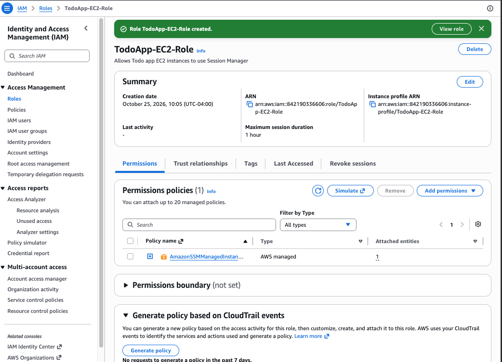

If an instance is already running without the role, select it and choose **Actions → Security → Modify IAM role**. See [troubleshooting.md → Instance launched without the IAM role](troubleshooting.md#instance-launched-without-the-iam-role).

## 2. Launch the instances

In the **EC2** console, choose **Launch instances** and create the first instance:

| Setting | Value |
|---|---|
| Name | `web-server-1` |
| AMI | Amazon Linux 2023 (64-bit x86) |
| Instance type | `t3.micro` |
| Key pair | **Create new key pair**: RSA, `.pem` |
| VPC | `TodoAppVPC` |
| Subnet | `TodoApp-Subnet-Public-A` |
| Auto-assign public IP | Enable |
| Security group | `Webserver-SG` |
| IAM instance profile (under **Advanced details**) | `TodoApp-EC2-Role` |

Repeat for `web-server-2` in `TodoApp-Subnet-Public-B`.

Wait until both show **Running** and **3/3 checks passed**. (`Bastion-connect` in this screenshot is a leftover from an earlier attempt and was terminated. This architecture doesn't need a bastion, because the web servers are in public subnets with SSH limited to your IP.)

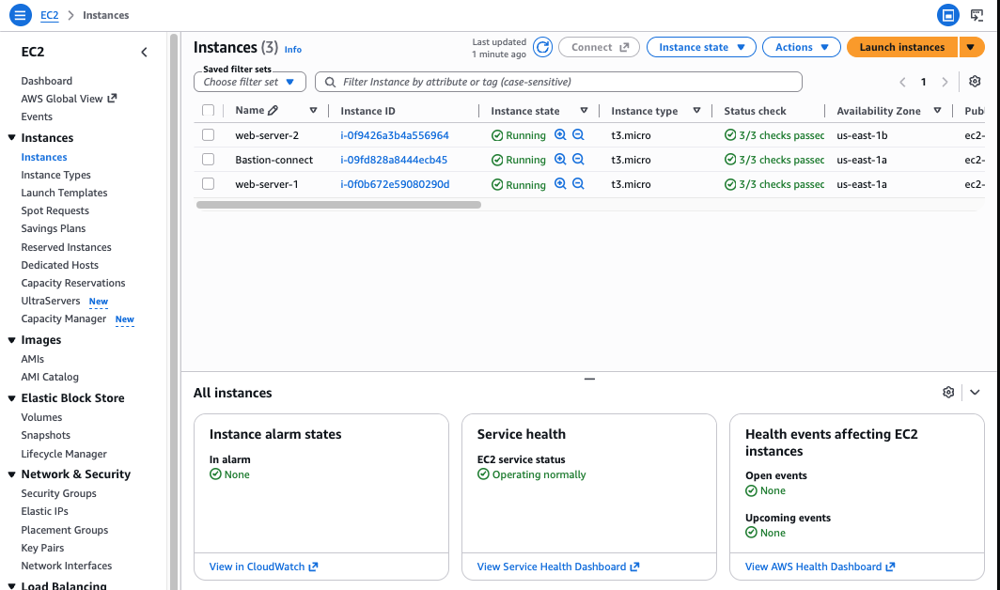

### Check each instance

**web-server-1**: `TodoAppVPC`, `TodoApp-Subnet-Public-A`, private IP `10.0.1.123`, with a public IP.

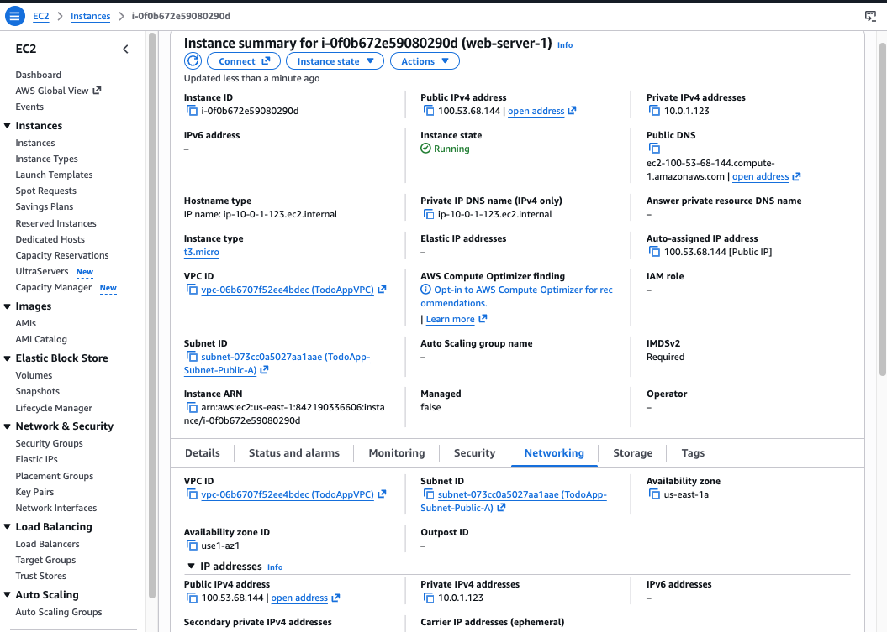

**Security** tab: IAM role `TodoApp-EC2-Role`, security group `Webserver-SG`.

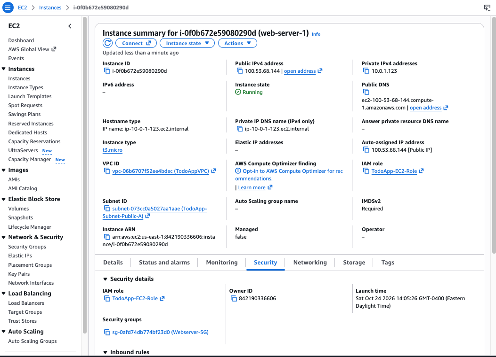

**Details** tab: Amazon Linux 2023 AMI, plus the key pair name you need for SSH.

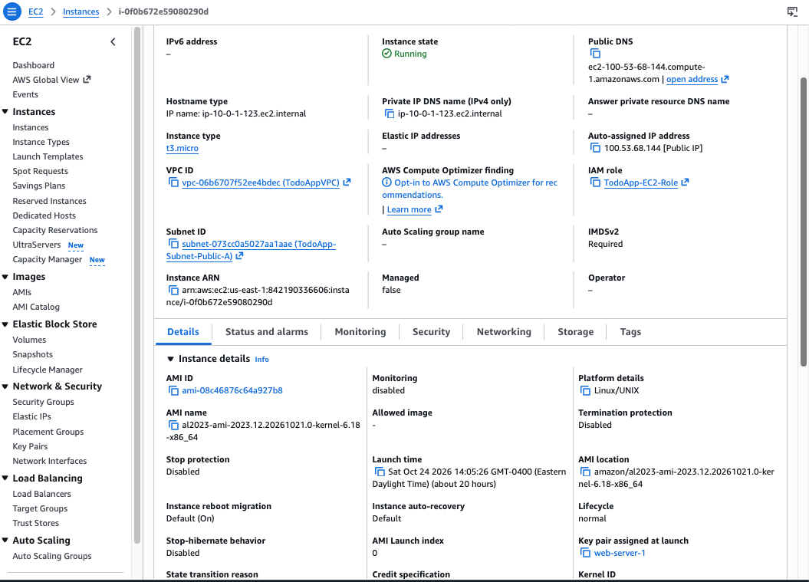

**web-server-2**: `TodoApp-Subnet-Public-B` (`us-east-1b`), private IP `10.0.3.137`, same role and security group.

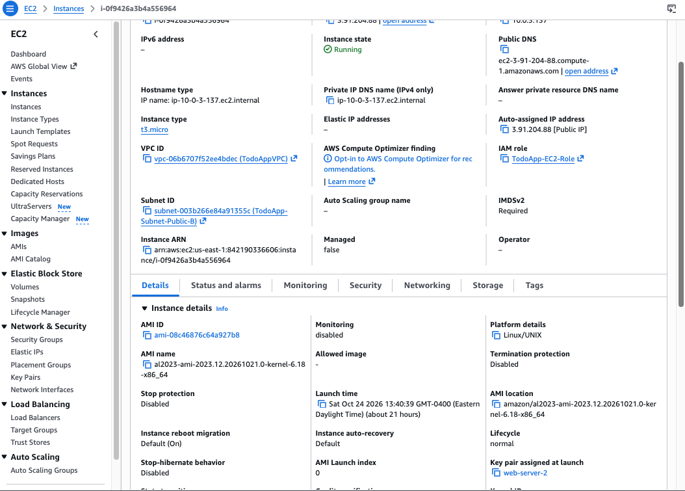

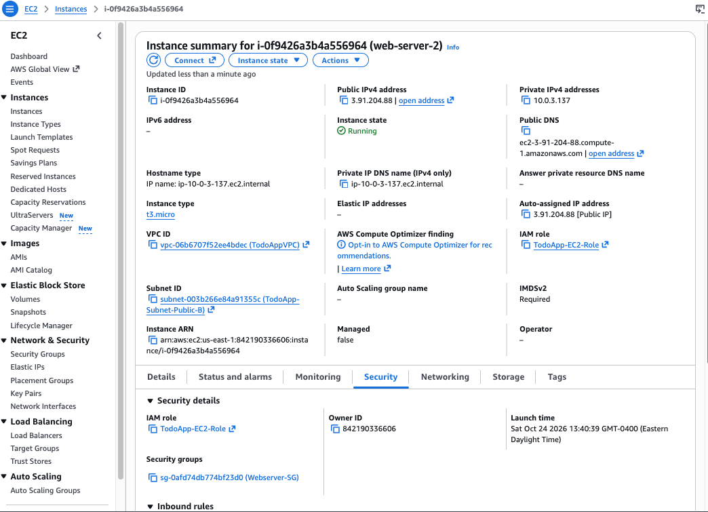

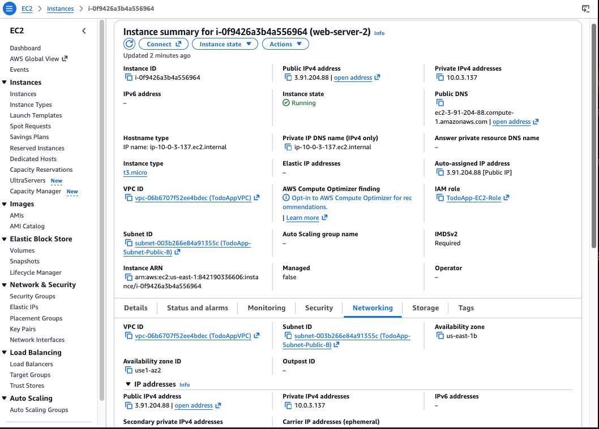

## 3. Install and configure the app

Do steps 3.1–3.4 and 3.6–3.7 on **both** instances. Do step 3.5 on **one** instance only, because both share the same database.

### 3.1 Connect

```bash
chmod 400 ~/.ssh/web-server-1.pem
ssh -i ~/.ssh/web-server-1.pem ec2-user@<instance-public-ip>
```

The prompt changes to `[ec2-user@ip-10-0-x-x ~]$`. The "post-quantum key exchange" warning and the "newer release of Amazon Linux" message are harmless.

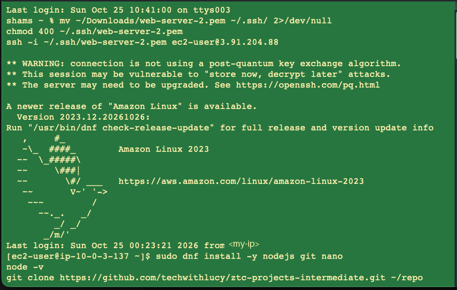

If SSH times out, your public IP has probably changed. See [troubleshooting.md → SSH: Operation timed out](troubleshooting.md#ssh-operation-timed-out). Or use **Connect → Session Manager → Connect**, then run `sudo su - ec2-user`.

### 3.2 Install Node.js and tools

```bash
sudo dnf install -y nodejs git nano
node -v
```

### 3.3 Clone the app and install dependencies

```bash
git clone https://github.com/techwithlucy/ztc-projects-intermediate.git ~/repo
ln -s ~/repo/projects/intermediate/project5 ~/todo-app
cd ~/todo-app
npm install --omit=dev
```

### 3.4 Create `.env`

```bash
cat > ~/todo-app/.env <<'EOF'
DB_HOST=todo-instance-lab5.xxxxxxxx.us-east-1.rds.amazonaws.com
DB_USER=admin
DB_PASSWORD=CHANGE_ME
DB_NAME=todo_app
API_BASE_URL=http://localhost:3000
EOF
chmod 600 ~/todo-app/.env
nano ~/todo-app/.env
```

Replace `CHANGE_ME` with the RDS master password in nano, so it doesn't end up in your shell history. Set `API_BASE_URL` to the ALB URL later, in [setup-alb.md](setup-alb.md).

Test the connection. This uses the app's own `mysql2` driver, so you don't need a MySQL client:

```bash
cd ~/todo-app
node -e "
require('dotenv').config();
require('mysql2/promise').createConnection({
  host: process.env.DB_HOST, user: process.env.DB_USER, password: process.env.DB_PASSWORD
}).then(async c => {
  const [r] = await c.query('SELECT VERSION() AS version, @@require_secure_transport AS tls_required');
  console.log('CONNECTED', r[0]);
  await c.end();
}).catch(e => console.error('FAILED', e.code, e.message));
"
```

| Result | Meaning |
|---|---|
| `CONNECTED { version: '8.4.x', tls_required: 0 }` | Ready |
| `CONNECTED ... tls_required: 1` | RDS requires TLS. See [troubleshooting.md](troubleshooting.md#rds-requires-tls) |
| `FAILED ETIMEDOUT` | `TodoApp-Database-SG` doesn't allow `3306` from `Webserver-SG`, or the DB is in another VPC |
| `FAILED ER_ACCESS_DENIED_ERROR` | Wrong user or password in `.env` |

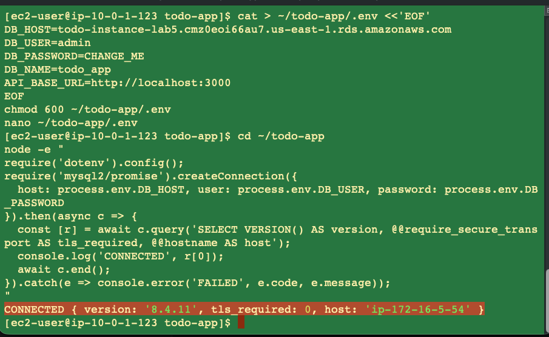

### 3.5 Create the schema (one instance only)

```bash
cd ~/todo-app
node -e "
require('dotenv').config();
require('mysql2/promise').createConnection({
  host: process.env.DB_HOST, user: process.env.DB_USER, password: process.env.DB_PASSWORD
}).then(async c => {
  await c.query('CREATE DATABASE IF NOT EXISTS todo_app');
  await c.query(\`CREATE TABLE IF NOT EXISTS todo_app.Tasks (
    id               INT AUTO_INCREMENT PRIMARY KEY,
    task_name        VARCHAR(255) NOT NULL,
    task_description TEXT,
    due_date         DATE,
    completed        TINYINT(1) NOT NULL DEFAULT 0,
    created_at       TIMESTAMP DEFAULT CURRENT_TIMESTAMP
  )\`);
  const [cols] = await c.query('SHOW COLUMNS FROM todo_app.Tasks');
  console.log('TABLE READY:', cols.map(x => x.Field).join(', '));
  await c.end();
}).catch(e => console.error('FAILED', e.code, e.message));
"
```

This is the same SQL as [db/schema.sql](../db/schema.sql). If that file is in your clone, you can load it with any MySQL client instead.

### 3.6 Run the app as a systemd service

```bash
NODE_BIN=$(which node)
sudo tee /etc/systemd/system/todo-app.service > /dev/null <<EOF
[Unit]
Description=To-Do App
After=network.target

[Service]
WorkingDirectory=/home/ec2-user/todo-app
ExecStart=$NODE_BIN index.js
Restart=always
User=ec2-user

[Install]
WantedBy=multi-user.target
EOF
sudo systemctl daemon-reload
sudo systemctl enable --now todo-app
sudo systemctl status todo-app --no-pager
```

### 3.7 Test on the instance

```bash
curl -s localhost:3000/tasks; echo
curl -s -X POST localhost:3000/tasks -H 'Content-Type: application/json' \
  -d '{"taskName":"Test from web-server-1","dueDate":"2026-10-31"}'; echo
curl -s -o /dev/null -w 'Homepage HTTP %{http_code}\n' localhost:3000/
```

Expect a JSON list, `Task created successfully`, and `Homepage HTTP 200`.

**web-server-1**: the service is `active (running)`, the list starts empty (`[]`), task 1 is created, and the homepage returns 200.

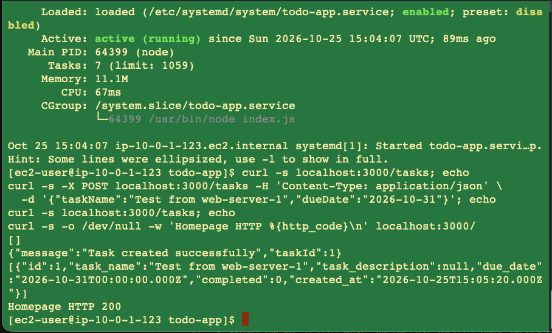

**web-server-2**: the first `GET /tasks` already returns "Test from web-server-1", which proves both servers share the same RDS database. Its own task becomes task 2.

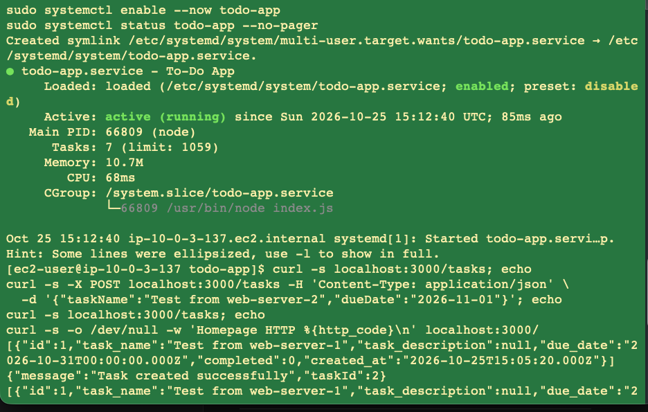

## Viewing logs

```bash
journalctl -u todo-app -f
```

## Updating the code

```bash
cd ~/repo && git pull
cd ~/todo-app && npm install --omit=dev
sudo systemctl restart todo-app
```

Run this on both instances.

## Next step

[Create the Application Load Balancer](setup-alb.md).
