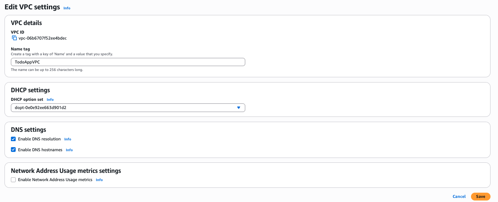
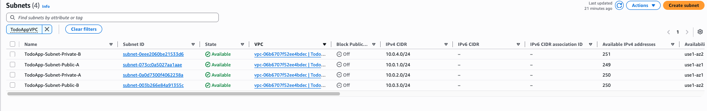
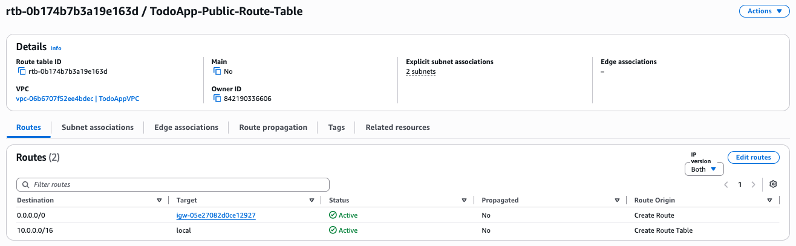
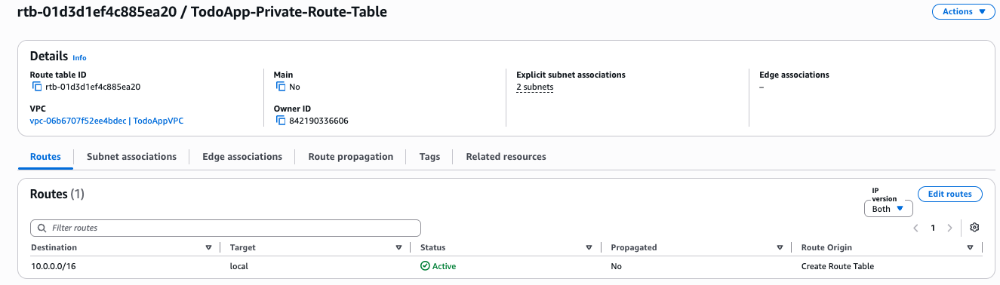
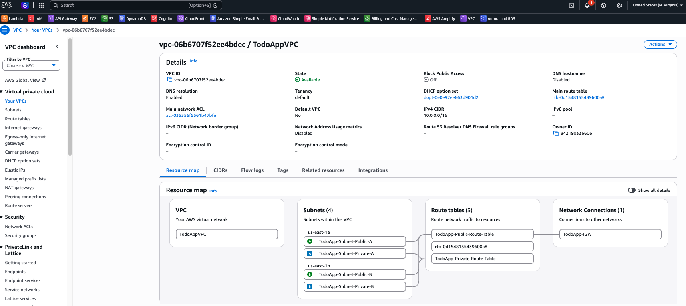
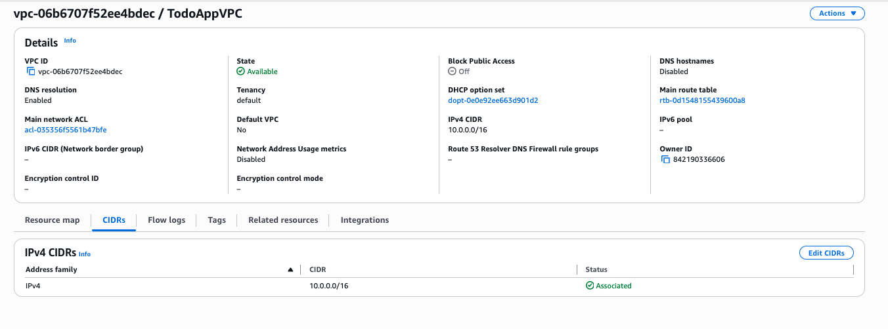
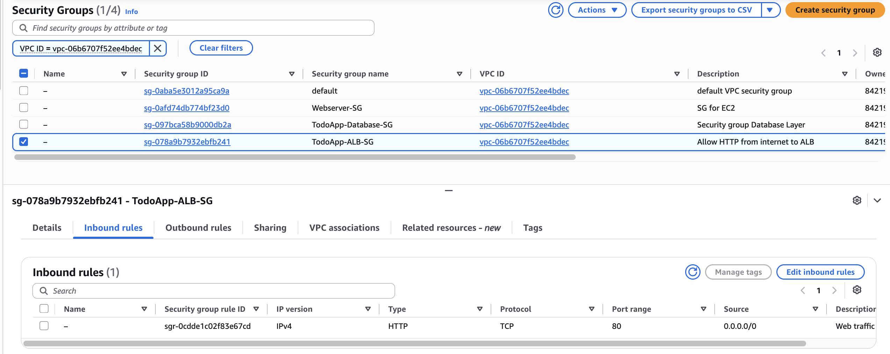
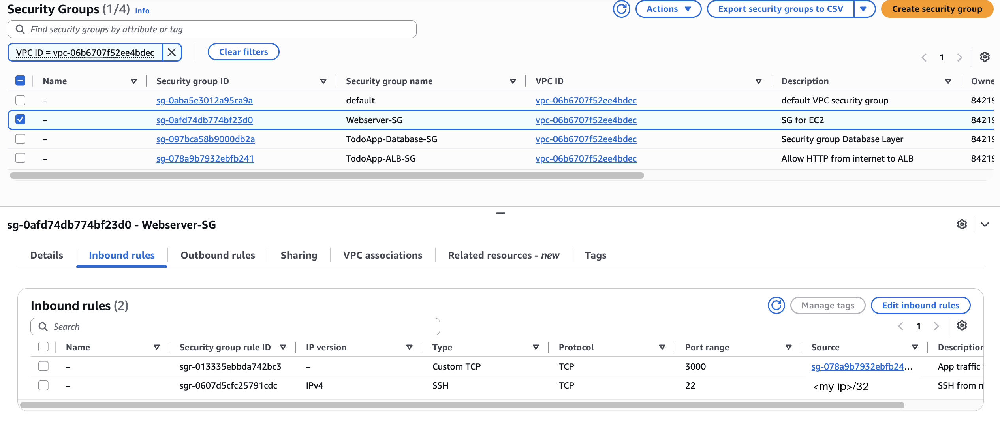
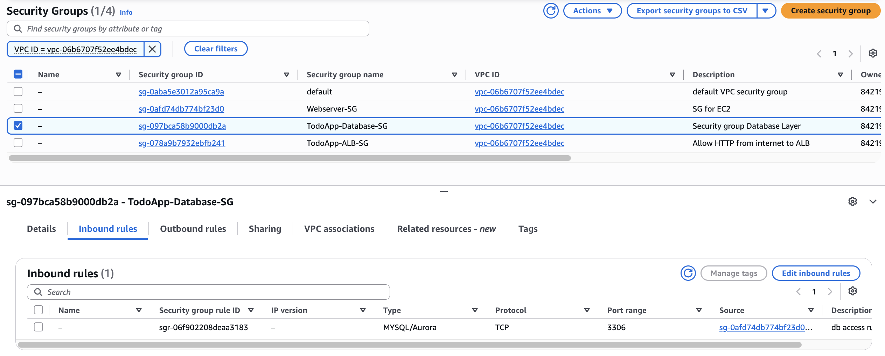

# Set up the network (VPC, subnets, route tables, security groups)

This guide creates the network that every other component runs in. Use the same Region (`us-east-1`) throughout the project.

If something doesn't match, see [troubleshooting.md](troubleshooting.md).

## 1. Create the VPC and subnets

1. Open the **VPC** console, go to **Your VPCs** and choose **Create VPC**.
2. Choose **VPC only**:
   - **Name:** `TodoAppVPC`
   - **IPv4 CIDR:** `10.0.0.0/16`
   - **IPv6 CIDR block:** none
   - **Tenancy:** Default
3. Select the VPC, choose **Actions → Edit VPC settings**, check **Enable DNS hostnames** and save.

   

4. Go to **Subnets → Create subnet**, select `TodoAppVPC` and add four subnets:

   | Name | Availability Zone | CIDR |
   |---|---|---|
   | `TodoApp-Subnet-Public-A` | `us-east-1a` | `10.0.1.0/24` |
   | `TodoApp-Subnet-Private-A` | `us-east-1a` | `10.0.2.0/24` |
   | `TodoApp-Subnet-Public-B` | `us-east-1b` | `10.0.3.0/24` |
   | `TodoApp-Subnet-Private-B` | `us-east-1b` | `10.0.4.0/24` |

   > The architecture diagram shows Public-B as `10.0.2.0/24` and Private-A as `10.0.3.0/24`. This deployment has them swapped. It makes no functional difference, because the route table, not the CIDR, makes a subnet public or private.

   

5. For each **public** subnet, choose **Actions → Edit subnet settings** and enable **Auto-assign public IPv4 address**. The instances need a public IP for SSH, package downloads and Session Manager. Leave this off for the private subnets.

## 2. Create the Internet Gateway

1. Go to **Internet gateways → Create internet gateway** and name it `TodoApp-IGW`.
2. Choose **Actions → Attach to VPC** and select `TodoAppVPC`.

## 3. Create the route tables

**Public route table**

1. **Route tables → Create route table**: name `TodoApp-Public-Route-Table`, VPC `TodoAppVPC`.
2. **Routes → Edit routes → Add route**: destination `0.0.0.0/0`, target **Internet Gateway → `TodoApp-IGW`**.
3. **Subnet associations → Edit subnet associations**: select both public subnets.

**Private route table**

1. Create `TodoApp-Private-Route-Table` in `TodoAppVPC`.
2. Leave the routes as they are (only `10.0.0.0/16 → local`).
3. Associate both private subnets.

With no route to the internet, nothing outside the VPC can reach the database.

## 4. Check the VPC

Open `TodoAppVPC` and check the **Resource map** tab. It should show the four subnets, each wired to the correct route table, and the public route table connected to `TodoApp-IGW`. The third route table (`rtb-...` with no name) is the VPC's main route table, which AWS creates automatically. No subnet uses it.

The **CIDRs** tab should show `10.0.0.0/16` as **Associated**.

## 5. Create the security groups

Go to **VPC → Security → Security groups** (or **EC2 → Network & Security → Security Groups**) and choose **Create security group**. Create all three groups in `TodoAppVPC`, in this order, because each one refers to the one before it.

| Name | Inbound rule | Source |
|---|---|---|
| `TodoApp-ALB-SG` | HTTP, port `80` | **Anywhere-IPv4** `0.0.0.0/0` |
| `Webserver-SG` | Custom TCP, port `3000` | **Custom** → `TodoApp-ALB-SG` |
| `Webserver-SG` | SSH, port `22` | **My IP** |
| `TodoApp-Database-SG` | MYSQL/Aurora, port `3306` | **Custom** → `Webserver-SG` |

Leave the outbound rules at their default (all traffic).

Using security group IDs as sources means only the ALB can reach the app, and only the app instances can reach the database.

The SSH rule is optional. **My IP** fills in your current public IP as a `/32`, so only your machine can connect. Never use `0.0.0.0/0` for SSH. If your IP changes (new network, VPN), edit the rule and select **My IP** again. Without the SSH rule, use Session Manager instead.

**`TodoApp-ALB-SG`**

**`Webserver-SG`**: port 3000 from the ALB's security group, plus SSH from your IP only.

**`TodoApp-Database-SG`**: MySQL only from `Webserver-SG`.

> **Common mistake:** opening SSH, HTTP and MySQL on `Webserver-SG` to `0.0.0.0/0`. See [troubleshooting.md → Web server security group open to the internet](troubleshooting.md#web-server-security-group-open-to-the-internet).

## Next step

[Set up the RDS database](setup-rds.md).
