# Troubleshooting

Problems we hit while deploying this project, and how each was fixed. Problems that come up often but didn't happen here are listed at the end.

**Contents**

- Network and security
  - [Subnet CIDRs don't match the diagram](#subnet-cidrs-dont-match-the-diagram)
  - [Web server security group open to the internet](#web-server-security-group-open-to-the-internet)
  - [SSH: Operation timed out](#ssh-operation-timed-out)
- Database
  - [Can't find the RDS networking details](#cant-find-the-rds-networking-details)
  - [RDS subnet group includes public subnets](#rds-subnet-group-includes-public-subnets)
  - [Schema file and MySQL client not on the instance](#schema-file-and-mysql-client-not-on-the-instance)
  - [RDS requires TLS](#rds-requires-tls)
- EC2
  - [Instance launched without the IAM role](#instance-launched-without-the-iam-role)
  - [Extra instance not in the architecture](#extra-instance-not-in-the-architecture)
  - [Harmless messages in the terminal](#harmless-messages-in-the-terminal)
- Load balancer and app
  - [Target group shows targets as Unused](#target-group-shows-targets-as-unused)
  - [Page loads but the list is empty and Add Task does nothing](#page-loads-but-the-list-is-empty-and-add-task-does-nothing)
  - [`curl /config` prints nothing after a restart](#curl-config-prints-nothing-after-a-restart)
- [Other common problems](#other-common-problems)
- [Useful diagnostic commands](#useful-diagnostic-commands)

---

## Network and security

### Subnet CIDRs don't match the diagram

**Symptom:** the subnets list shows Public-B as `10.0.3.0/24` and Private-A as `10.0.2.0/24`, but the architecture diagram has them the other way round.

**Cause:** the CIDRs were typed in a different order when the subnets were created.

**Fix:** none needed. A subnet is public or private because of its **route table**, not its CIDR. The docs use the deployed values. If you want to match the diagram exactly, delete and recreate the two subnets **before** putting anything in them. You can't change a subnet's CIDR after it's created.

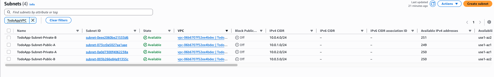

### Web server security group open to the internet

**Symptom:** `Webserver-SG` allows SSH 22, HTTP 80 and MySQL 3306 from `0.0.0.0/0`.

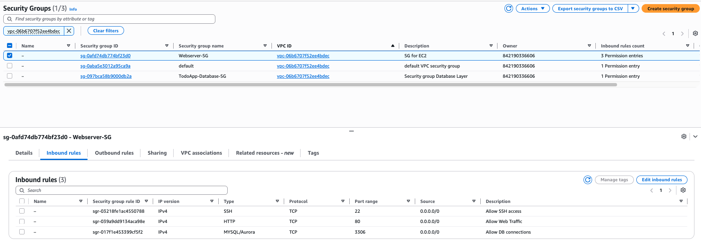

**Why it's wrong:**

| Rule | Problem |
|---|---|
| SSH 22 from `0.0.0.0/0` | Anyone on the internet can attempt to log in |
| HTTP 80 from `0.0.0.0/0` | The app listens on **3000**, not 80, and this lets users bypass the ALB |
| MySQL 3306 from `0.0.0.0/0` | MySQL runs on RDS, not on EC2. The instances only make **outbound** connections to the DB, which the default outbound rule already allows |
| *(missing)* | Nothing allows the ALB to reach port 3000 |

**Fix:**

1. Create `TodoApp-ALB-SG` first (HTTP 80 from `0.0.0.0/0`).
2. In `Webserver-SG`, choose **Edit inbound rules**, delete the HTTP 80 and MySQL 3306 rules, change SSH's source to **My IP**, and add **Custom TCP 3000** from `TodoApp-ALB-SG`.

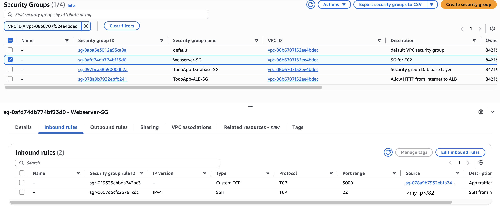

The `default` security group and `TodoApp-Database-SG` were already correct:

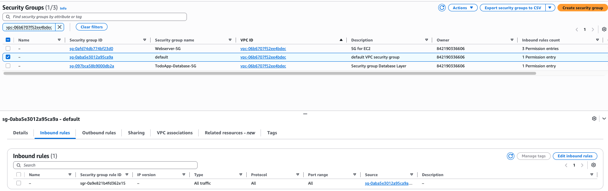

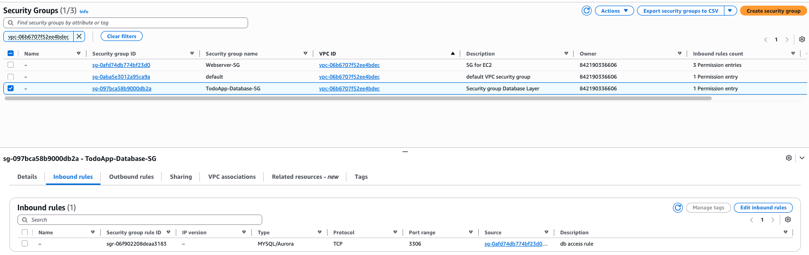

### SSH: Operation timed out

**Symptom:**

```
ssh: connect to host 100.53.68.144 port 22: Operation timed out
```

**Cause:** the SSH rule in `Webserver-SG` allows only the IP you had when you created it (`/32`). Your public IP changed: a different Wi-Fi network, a VPN turning on or off, or your internet provider assigning a new address.

**Diagnose** from your machine:

```bash
curl -4 -s https://checkip.amazonaws.com      # your current public IP
nc -vz -G 5 <instance-public-ip> 22           # times out if blocked
```

If the IP doesn't match the SSH rule's source, that's the cause.

**Fix:** **EC2 → Security Groups → `Webserver-SG` → Edit inbound rules**. On the SSH rule, choose **Source → My IP** again, then **Save rules**.

**Alternative:** use **Session Manager**, which needs no open port or key. Select the instance, choose **Connect → Session Manager → Connect**, then run `sudo su - ec2-user`. This requires the [IAM role](#instance-launched-without-the-iam-role).

Other causes of an SSH timeout: the instance has no public IP, the subnet's route table has no `0.0.0.0/0 → IGW` route, or the instance is stopped.

**Related prompt (harmless):** `override r-------- ... for ~/.ssh/web-server-1.pem? (y/n)` appears when `mv` replaces a key that's already read-only (`chmod 400`). Answer `y`.

---

## Database

### Can't find the RDS networking details

**Symptom:** the **Connectivity & security** tab has no **Networking** section (VPC, subnet group, publicly accessible). It only shows connection snippets, connected compute resources and security group rules.

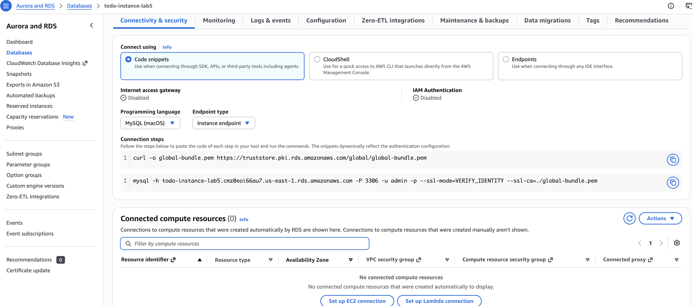

**Cause:** AWS redesigned the RDS console.

**Fix:** find each detail elsewhere:

| Detail | Where to find it |
|---|---|
| VPC, Multi-AZ | **Databases** list (scroll right) |
| Subnet group and its subnets | Sidebar → **Subnet groups** → pick the one in your VPC |
| Engine version | Database → **Configuration** tab |
| Publicly accessible | **Configuration** tab, or **Modify → Connectivity → Additional configuration** (then **Cancel**) |
| Endpoint | **Connectivity & security → Connection steps** snippet |

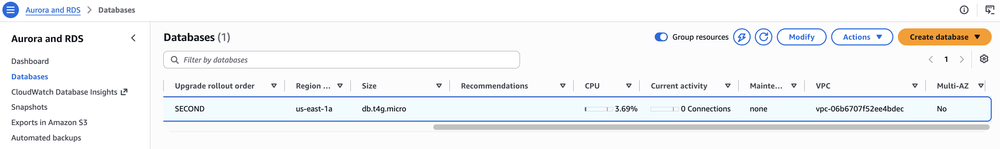

You can also check whether the database is public, and which subnet it's in, by resolving its endpoint:

```bash
dig +short <db-endpoint> @8.8.8.8
```

A `10.0.x.x` address means it isn't publicly accessible. The third number shows the subnet: `10.0.2.x` is Private-A.

### RDS subnet group includes public subnets

**Symptom:** the DB's subnet group is `default-vpc-<id>` and lists all four subnets.

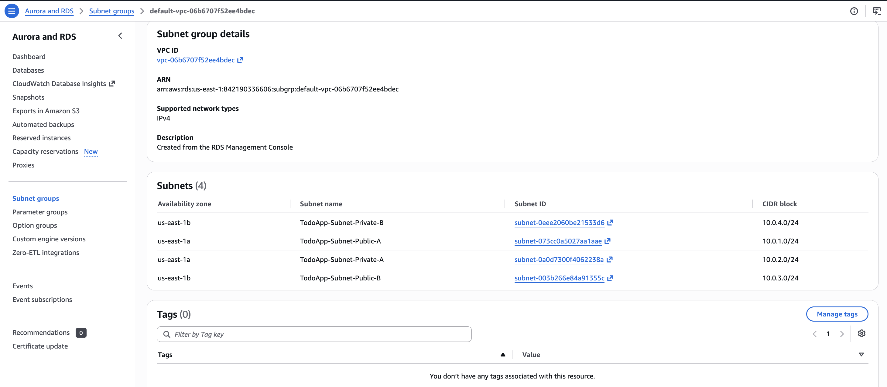

**Cause:** when you create a database without choosing a subnet group, the console auto-creates one with **every** subnet in the VPC. RDS can then put the DB, or a future standby or restore, in a public subnet.

**Check where the DB actually is:** `dig +short <db-endpoint> @8.8.8.8` returned `10.0.2.246`, so it's in Private-A. That makes it safe to edit the group.

**Fix:** **Subnet groups → select the group → Edit**. Uncheck `10.0.1.0/24` and `10.0.3.0/24` (the public subnets) and keep `10.0.2.0/24` and `10.0.4.0/24`. Click **Save**. This doesn't restart the database.

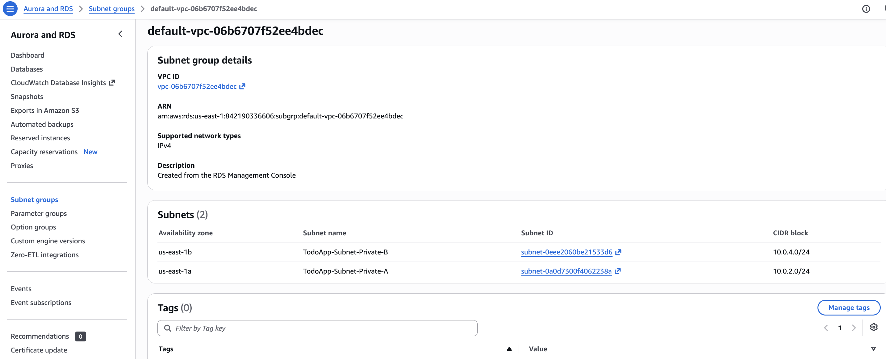

If the DB is already **in** a public subnet, you can't remove that subnet from its group. Because this DB is empty, the simplest fix is to delete it and recreate it with a subnet group containing only the private subnets.

### Schema file and MySQL client not on the instance

**Symptom:** `db/schema.sql` or `.env.example` is missing after `git clone`, or `mysql` reports `command not found`.

**Cause:** the GitHub repo has only the app code (`index.js`, `public/`, `package.json`). The schema and docs were written locally and haven't been pushed. Amazon Linux 2023 doesn't include a MySQL client. Its `mariadb105` package can also fail against MySQL 8.4 users that use `caching_sha2_password`.

**Fix:** create the schema with the app's own `mysql2` driver. See [setup-ec2.md → 3.5](setup-ec2.md#35-create-the-schema-one-instance-only). Create `.env` with the heredoc in [setup-ec2.md → 3.4](setup-ec2.md#34-create-env).

### RDS requires TLS

**Symptom:** the connection test prints `tls_required: 1`, or the app fails with `HANDSHAKE_SSL_REQUIRED` or a "secure transport required" error.

**Status in this deployment:** not needed. The test returned `tls_required: 0` on MySQL 8.4.11.

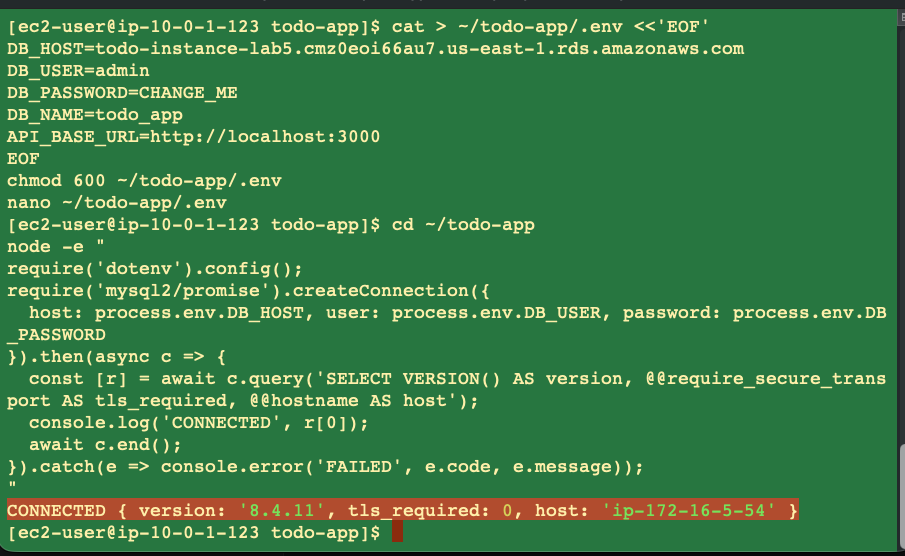

**Fix if you need it:** `mysql2` ships AWS's RDS certificates, so in `index.js` add `ssl` to the pool options:

```js
const db = mysql.createPool({
  host: process.env.DB_HOST,
  user: process.env.DB_USER,
  password: process.env.DB_PASSWORD,
  database: process.env.DB_NAME,
  ssl: 'Amazon RDS',
});
```

---

## EC2

### Instance launched without the IAM role

**Symptom:** the instance's **IAM role** field shows `–`, and **Connect → Session Manager** is unavailable.

**Fix:** select the instance, then **Actions → Security → Modify IAM role → `TodoApp-EC2-Role` → Update IAM role**. No restart is needed. Check the instance's **Security** tab.

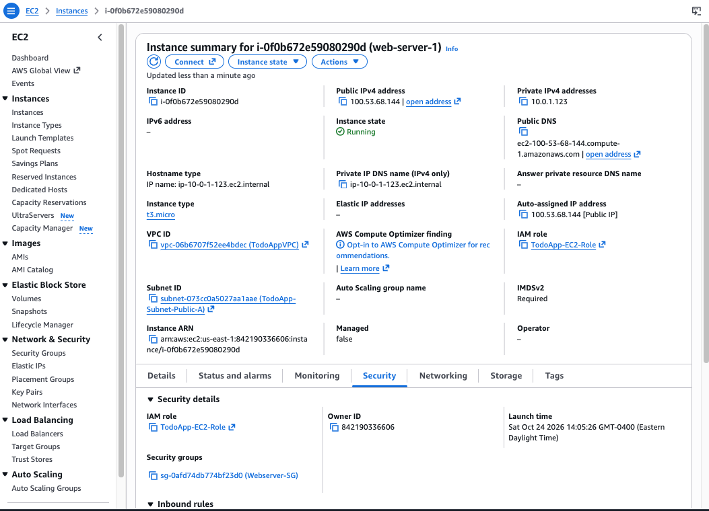

Session Manager can take up to 30 minutes to recognise the new role. To speed it up, run `sudo systemctl restart amazon-ssm-agent` over SSH, or reboot the instance.

### Extra instance not in the architecture

**Symptom:** a `Bastion-connect` instance was running next to the two web servers.

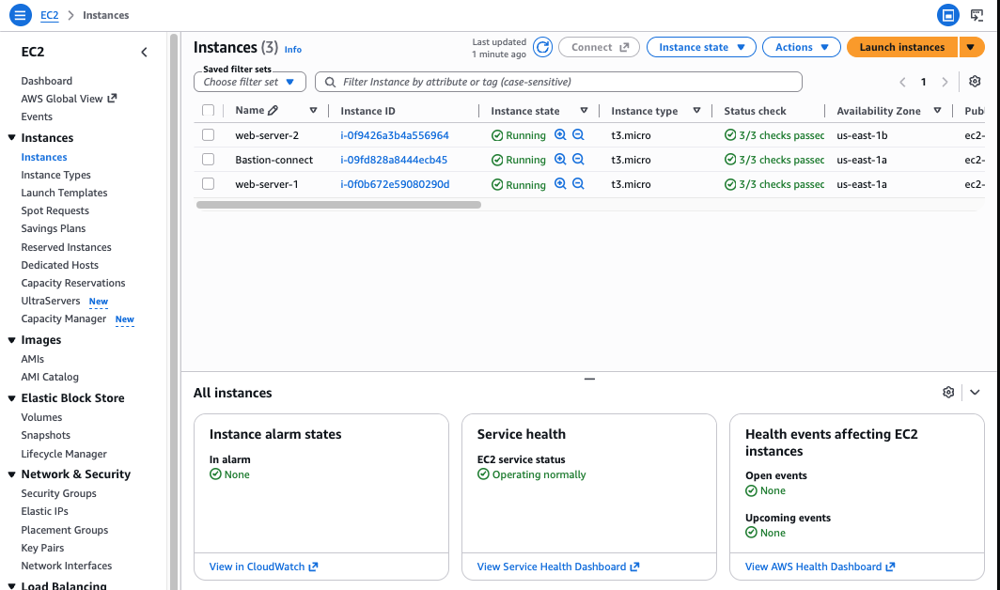

**Fix:** the web servers are in public subnets with SSH limited to your IP (plus Session Manager), so a bastion isn't needed. Terminate it with **Instance state → Terminate (delete) instance**, so you aren't charged for it.

### Harmless messages in the terminal

| Message | Meaning |
|---|---|
| `WARNING: connection is not using a post-quantum key exchange algorithm` | Your Mac's newer OpenSSH client noticing that the server is older. The connection is still encrypted. |
| `A newer release of "Amazon Linux" is available` | Optional OS update (`sudo dnf upgrade --releasever=<version>`). |
| `^[[200~` / `^[[201~` and `$'\E[200~cd': command not found` | Bracketed-paste markers leaking into the shell when pasting several lines. Run the affected command again. The rest of the paste runs normally. |

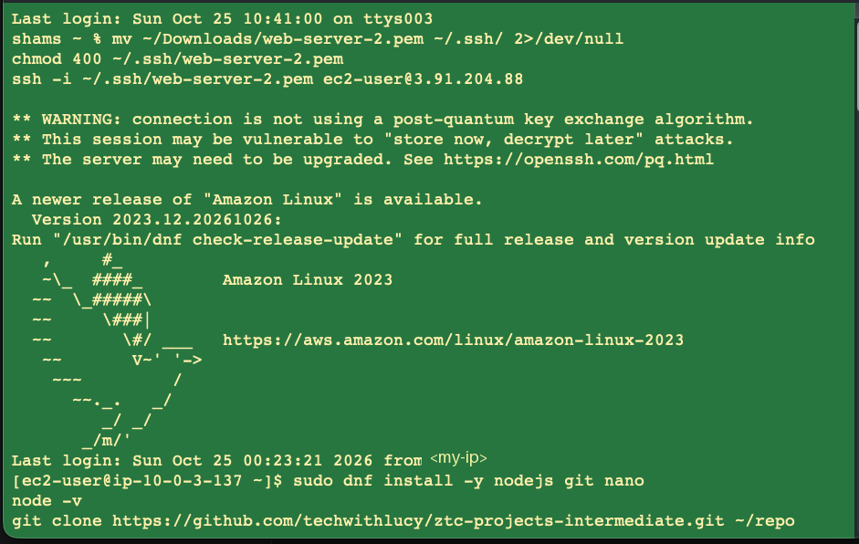

---

## Load balancer and app

### Target group shows targets as Unused

**Symptom:** right after you create `TodoApp-TG`, both targets show **Unused** ("Target group is not configured to receive traffic from the load balancer").

**Fix:** none needed. Health checks only start once a load balancer listener forwards to the target group. Create the ALB, and within about 30 seconds of it becoming **Active** both targets turn **Healthy**.

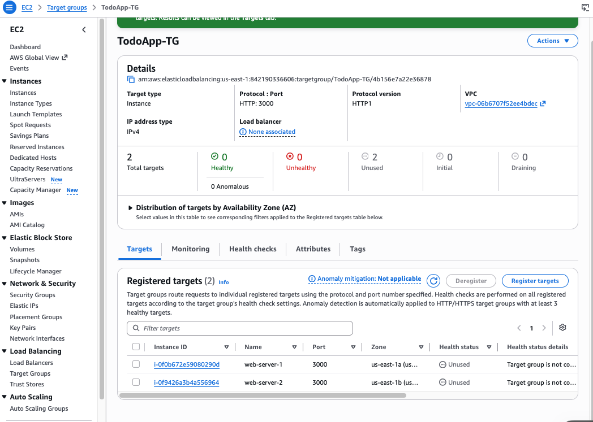

If targets become **Unhealthy** after the ALB exists:

- `Webserver-SG` must allow TCP **3000** from `TodoApp-ALB-SG`.
- The app must be running: `sudo systemctl status todo-app`.
- The target port must be **3000**, and the health check path `/` must return 200: `curl -s -o /dev/null -w '%{http_code}\n' localhost:3000/`.

### Page loads but the list is empty and Add Task does nothing

**Symptom:** `http://<alb-dns-name>` shows the To-Do page, but no tasks appear, even though the database has some, and clicking **Add Task** does nothing.

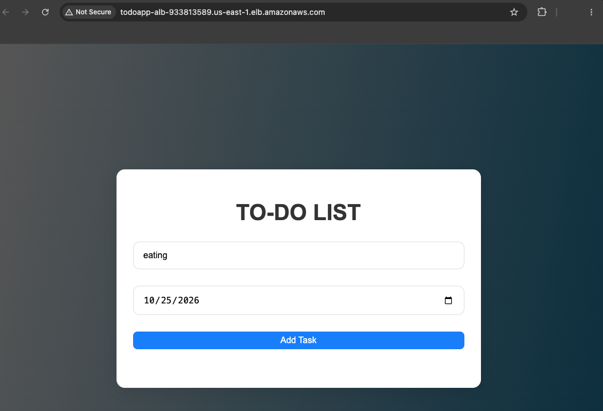

**Cause:** the frontend asks `/config` where the API is. `API_BASE_URL` was still `http://localhost:3000`, so the browser sent its API calls to **your own computer**, which has nothing on port 3000. The requests failed silently. The errors only show in the browser's **Console**.

**Diagnose** from your machine:

```bash
curl -s http://<alb-dns-name>/config     # {"API_BASE_URL":"http://localhost:3000"} = wrong
curl -s http://<alb-dns-name>/tasks      # tasks returned = API and DB are fine
```

Run `/config` several times. The ALB alternates between servers, and **both** must return the ALB URL.

**Fix:** on **both** instances, update `.env` and **restart**, because the app only reads `.env` at startup:

```bash
cd ~/todo-app
sed -i 's|^API_BASE_URL=.*|API_BASE_URL=http://<alb-dns-name>|' .env
sudo systemctl restart todo-app
```

Then hard-refresh the browser (**Cmd+Shift+R**).

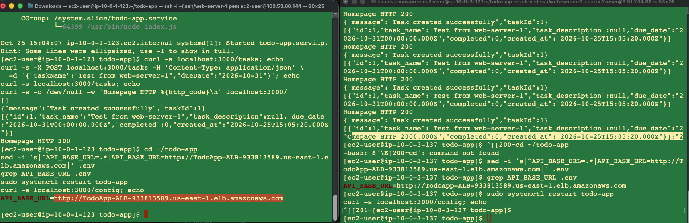

### `curl /config` prints nothing after a restart

**Symptom:** `sudo systemctl restart todo-app && curl -s localhost:3000/config` prints an empty line.

**Cause:** `curl` ran before Node.js was listening again, and `-s` hides the "connection refused" error.

**Fix:** wait a moment first: `sleep 2; curl -s localhost:3000/config`.

---

## Other common problems

| Symptom | Cause / fix |
|---|---|
| `GET /tasks` returns `500` | The app can't reach the DB. Check `.env`, and that `TodoApp-Database-SG` allows `3306` from `Webserver-SG`. Run `journalctl -u todo-app -n 30 --no-pager`. |
| `ER_NO_SUCH_TABLE` in the logs | The schema hasn't been created, or `DB_NAME` doesn't match. Run [setup-ec2.md → 3.5](setup-ec2.md#35-create-the-schema-one-instance-only). |
| `ER_ACCESS_DENIED_ERROR` | Wrong `DB_USER` or `DB_PASSWORD`. To reset the password: RDS → **Modify → New master password → Apply immediately**. |
| `ETIMEDOUT` connecting to RDS | Security group rule missing, or the DB is in a different VPC. |
| ALB returns `502` / `503` | No healthy targets. See [Target group shows targets as Unused](#target-group-shows-targets-as-unused). |
| ALB URL times out | `TodoApp-ALB-SG` is missing inbound HTTP 80, the ALB is in the private subnets, or you used `https://` (there's no 443 listener). |
| `todo-app` service keeps restarting | Run `journalctl -u todo-app -n 50 --no-pager`. Usually `.env` is missing or `npm install` wasn't run. |
| `Permission denied (publickey)` | Wrong key file or user. Use the key pair shown on the instance's **Details** tab, and user `ec2-user`. |
| `UNPROTECTED PRIVATE KEY FILE!` | Run `chmod 400 ~/.ssh/<key>.pem`. |

## Useful diagnostic commands

On an instance:

```bash
sudo systemctl status todo-app --no-pager     # is the app running?
journalctl -u todo-app -n 50 --no-pager       # app logs
curl -s localhost:3000/config; echo           # what the frontend will use
curl -s localhost:3000/tasks; echo            # API + DB check
grep -v PASSWORD ~/todo-app/.env              # config without the password
```

From your machine:

```bash
curl -4 -s https://checkip.amazonaws.com                 # your public IP (for the SSH rule)
dig +short <db-endpoint> @8.8.8.8                        # RDS private IP -> which subnet
for i in 1 2 3 4; do curl -s http://<alb-dns-name>/config; echo; done   # both targets
curl -s http://<alb-dns-name>/tasks                      # end-to-end through the ALB
```
