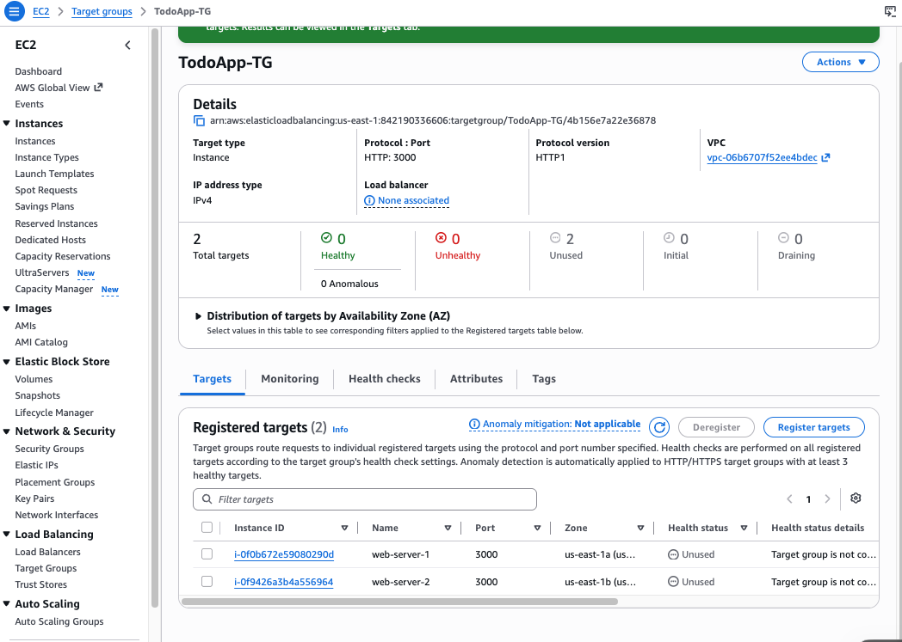
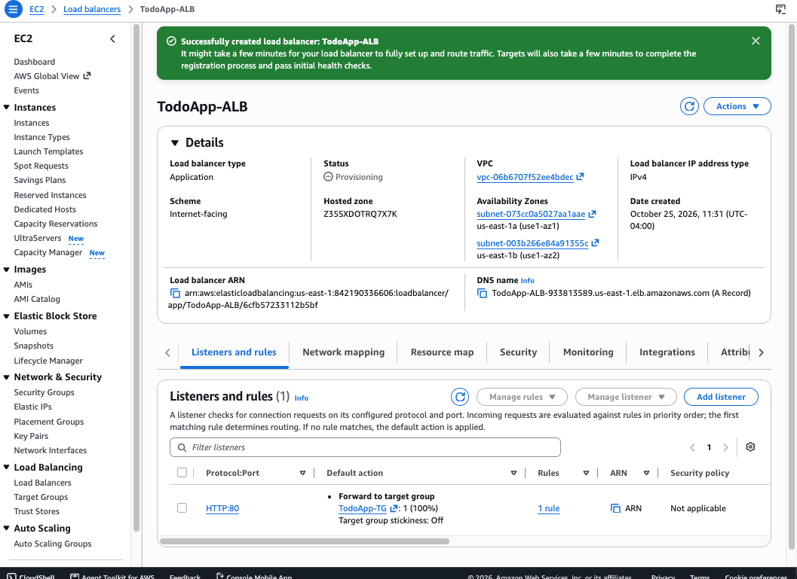
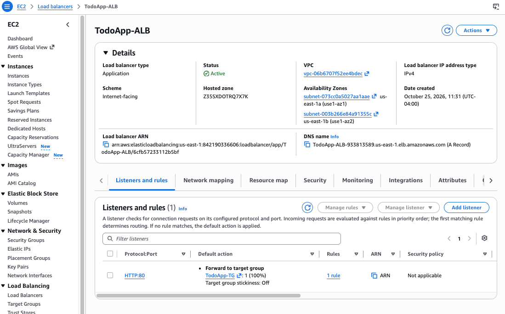

# Set up the Application Load Balancer

The ALB is the only public entry point. It listens on port `80` and forwards requests to port `3000` on the healthy instances.

If something doesn't match, see [troubleshooting.md](troubleshooting.md).

## 1. Create the target group

1. In the **EC2** console, go to **Load Balancing → Target Groups → Create target group**.
2. Use these settings:

   | Setting | Value |
   |---|---|
   | Target type | Instances |
   | Name | `TodoApp-TG` |
   | Protocol : Port | HTTP : `3000` |
   | IP address type | IPv4 |
   | VPC | `TodoAppVPC` |
   | Protocol version | HTTP1 |
   | Health check path | `/` |
   | Advanced health check settings | Healthy / unhealthy threshold `2`, interval `10` s, success codes `200` (faster failover for testing) |

3. Choose **Next**, select `web-server-1` and `web-server-2`, keep port `3000`, choose **Include as pending below**, then **Create target group**.

Both targets show **Unused** until a load balancer uses the target group. That's expected.



## 2. Create the load balancer

1. Go to **Load Balancing → Load Balancers → Create load balancer**, then choose **Create** under **Application Load Balancer**.
2. Use these settings:

   | Setting | Value |
   |---|---|
   | Name | `TodoApp-ALB` |
   | Scheme | Internet-facing |
   | IP address type | IPv4 |
   | VPC | `TodoAppVPC` |
   | Mappings | `us-east-1a` → `TodoApp-Subnet-Public-A`, `us-east-1b` → `TodoApp-Subnet-Public-B` (public subnets only) |
   | Security group | `ToDoApp-ALB-SG` (remove `default`) |
   | Listener | HTTP `80` → forward to `TodoApp-TG` |

3. Choose **Create load balancer**. The status starts as **Provisioning**.

   

4. After 3–5 minutes the status becomes **Active**. Copy the **DNS name**, for example `TodoApp-ALB-933813589.us-east-1.elb.amazonaws.com`.

   

> **Cost:** an ALB is billed hourly (about $16–20/month in us-east-1) and usually isn't free tier. Delete it when you're done. See [Clean up](../README.md#clean-up).

## 3. Point the app at the ALB

On **both** instances (over SSH or Session Manager, as `ec2-user`):

```bash
cd ~/todo-app
sed -i 's|^API_BASE_URL=.*|API_BASE_URL=http://<alb-dns-name>|' .env
grep API_BASE_URL .env
sudo systemctl restart todo-app
sleep 2; curl -s localhost:3000/config; echo
```

The last command should print `{"API_BASE_URL":"http://<alb-dns-name>"}`. Without the `sleep`, `curl` can run before the app is listening again and print nothing.


The frontend reads `API_BASE_URL` from `/config` and sends all API calls there. The app only reads `.env` at startup, so always restart the service after editing it. If you skip this, the page loads through the ALB but shows an empty list and **Add Task** does nothing, because the browser calls `localhost:3000` on your own machine. See [troubleshooting.md → Page loads but the list is empty and Add Task does nothing](troubleshooting.md#page-loads-but-the-list-is-empty-and-add-task-does-nothing).

Check from your own machine. Both targets should return the ALB URL, so run it a few times:

```bash
for i in 1 2 3 4; do curl -s http://<alb-dns-name>/config; echo; done
```

## 4. Test it

1. In **Target Groups → TodoApp-TG → Targets**, wait until both instances are **Healthy**.
2. Open `http://<alb-dns-name>` in a browser. Use `http://`: there's no HTTPS listener. Hard-refresh with **Cmd+Shift+R** (macOS) or **Ctrl+Shift+R**.
3. Add a few tasks, mark one complete (✔) and delete one (🗑).
4. Test the API directly:

   ```bash
   curl http://<alb-dns-name>/tasks
   ```

## 5. Test high availability

Stop the **app** rather than the instance. Stopping the instance gives it a new public IP when it starts again.

1. On `web-server-1`:

   ```bash
   sudo systemctl stop todo-app
   ```

2. Within about 20 seconds (two failed checks, 10 seconds apart), **Targets** shows `web-server-1` as **Unhealthy** and `web-server-2` as **Healthy**.
3. Refresh the app and add a task. It still works and all the tasks are still there, because the ALB sends traffic only to `web-server-2` and both instances share the same RDS database.
4. Start the app again. After about 20 seconds both targets are **Healthy**.

   ```bash
   sudo systemctl start todo-app
   ```

## Next steps (optional)

- Add an **HTTPS** listener on `443` with an ACM certificate, and redirect `80` to `443`.
- Replace the two instances with an **Auto Scaling group** that uses a launch template.
- Move the instances to private subnets with a NAT Gateway, so only the ALB is public.
- Store the database password in **Secrets Manager** instead of `.env`.
