# Set up the Application Load Balancer

The ALB is the only public entry point. It listens on port `80` and forwards requests to port `3000` on the healthy instances. Both instances use the same RDS database, so it doesn't matter which one answers.

If something doesn't match, see [troubleshooting.md](troubleshooting.md).

## 1. Create the target group

1. In the **EC2** console, go to **Load Balancing → Target Groups → Create target group**.
2. Use these settings:

   | Setting | Value |
   |---|---|
   | Target type | Instances |
   | Name | `TodoApp-TG` |
   | Protocol : Port | HTTP : `3000` |
   | IP address type | IPv4 |
   | VPC | `TodoAppVPC` (**not** the default VPC) |
   | Protocol version | HTTP1 |
   | Health check path | `/` |
   | Advanced health check settings | Healthy / unhealthy threshold `2`, interval `10` s, success codes `200` (faster failover for testing) |

3. Choose **Next**, select `web-server-1` and `web-server-2`, keep port `3000`, choose **Include as pending below**, then **Create target group**.

The **Register targets** page only lists running instances in the target group's VPC. If it shows **No instances**, refresh the page first. That was the fix in Run 2. Otherwise see [troubleshooting.md → Register targets lists no instances](troubleshooting.md#register-targets-lists-no-instances-run-2).

Both targets show **Unused** until a load balancer uses the target group. That's expected.

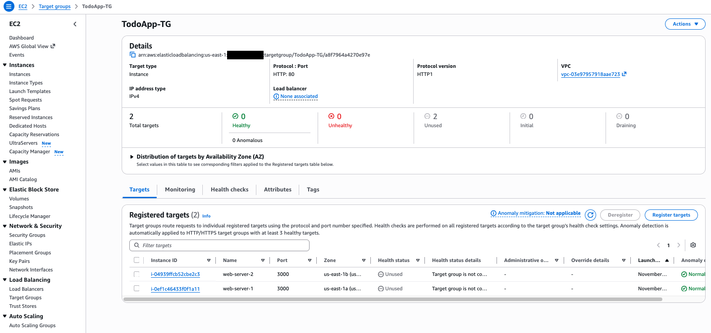

> **Port shown as HTTP:80?** In Run 2 the group's **Protocol : Port** was left at `80`, while both targets were registered on `3000`. That still works: the group's port is only the default for new targets, and traffic and health checks use each target's own port (**Traffic port**). Setting it to `3000` avoids the confusion.

## 2. Create the load balancer

1. Go to **Load Balancing → Load Balancers → Create load balancer**, then choose **Create** under **Application Load Balancer**.
2. Use these settings:

   | Setting | Value |
   |---|---|
   | Name | `TodoApp-ALB` |
   | Scheme | Internet-facing |
   | IP address type | IPv4 |
   | VPC | `TodoAppVPC` |
   | Mappings | `us-east-1a` → `TodoApp-Subnet-Public-A`, `us-east-1b` → `TodoApp-Subnet-Public-B` (public subnets only) |
   | Security group | `ToDoApp-ALB-SG` (remove `default`) |
   | Listener | HTTP `80` → forward to `TodoApp-TG` |

3. Choose **Create load balancer**. The status starts as **Provisioning**.

4. Check for a **⚠ Reachability may be impacted** warning next to the name. It means `ToDoApp-ALB-SG` is missing an inbound or outbound rule. In Run 2 the group had **no outbound rule**, so the ALB couldn't reach the targets:

   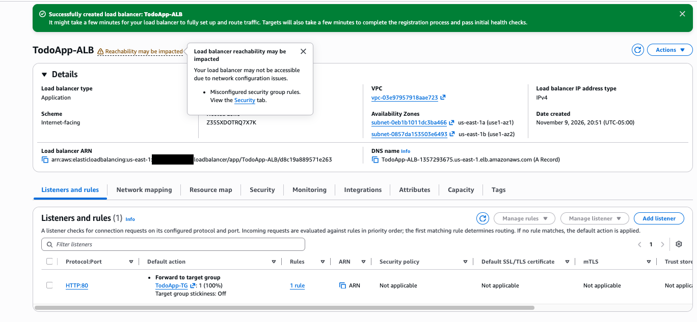

   Fix it before going on: add an outbound rule **Custom TCP `3000` → `ToDoApp-Webserver-SG`** to `ToDoApp-ALB-SG`. See [troubleshooting.md → ALB "Reachability may be impacted"](troubleshooting.md#alb-reachability-may-be-impacted-no-outbound-rule-run-2), and [setup-network.md → How the rules fit together](setup-network.md#how-the-rules-fit-together) for why each rule exists.

   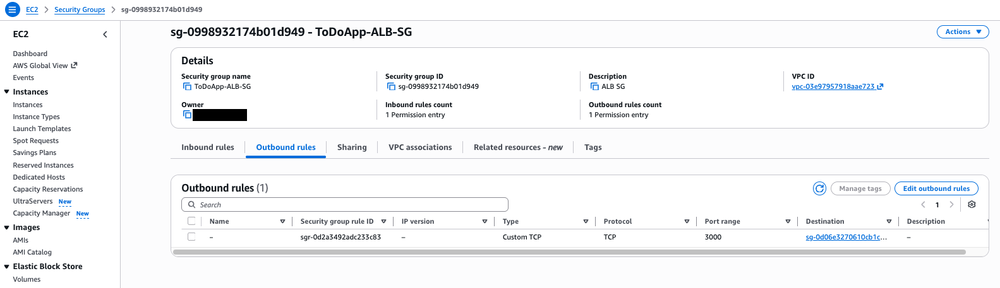

5. After 3–5 minutes the status becomes **Active** and the warning is gone. Check:
   - **Scheme:** Internet-facing, in `TodoAppVPC`
   - **Availability Zones:** `subnet-0eb1b1011dc3ba466` (Public-A, us-east-1a) and `subnet-0857da153503e6493` (Public-B, us-east-1b)
   - **Listener:** `HTTP:80` → forward to `TodoApp-TG` (100%)

   Copy the **DNS name**: `TodoApp-ALB-1357293675.us-east-1.elb.amazonaws.com`.

   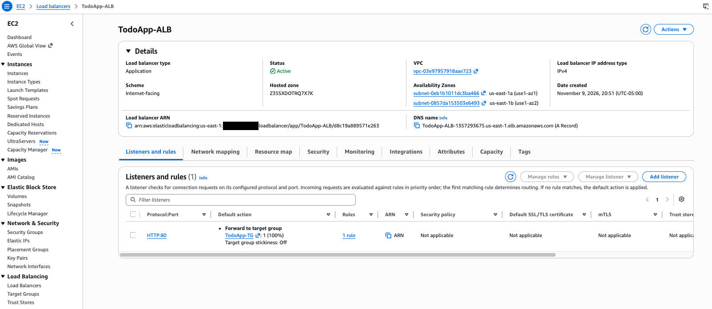

> **Cost:** an ALB is billed hourly (about $16–20/month in us-east-1) and usually isn't free tier. Delete it when you're done. See [teardown.md](teardown.md).

## 3. Point the app at the ALB

On **both** instances (over SSH or Session Manager, as `ec2-user`):

```bash
cd ~/todo-app
sed -i 's|^API_BASE_URL=.*|API_BASE_URL=http://TodoApp-ALB-1357293675.us-east-1.elb.amazonaws.com|' .env
grep API_BASE_URL .env
sudo systemctl restart todo-app
sleep 2; curl -s localhost:3000/config; echo
```

Use your own DNS name. The last command should print `{"API_BASE_URL":"http://TodoApp-ALB-1357293675.us-east-1.elb.amazonaws.com"}`. Without the `sleep`, `curl` can run before the app is listening again and print nothing.

**web-server-1:**

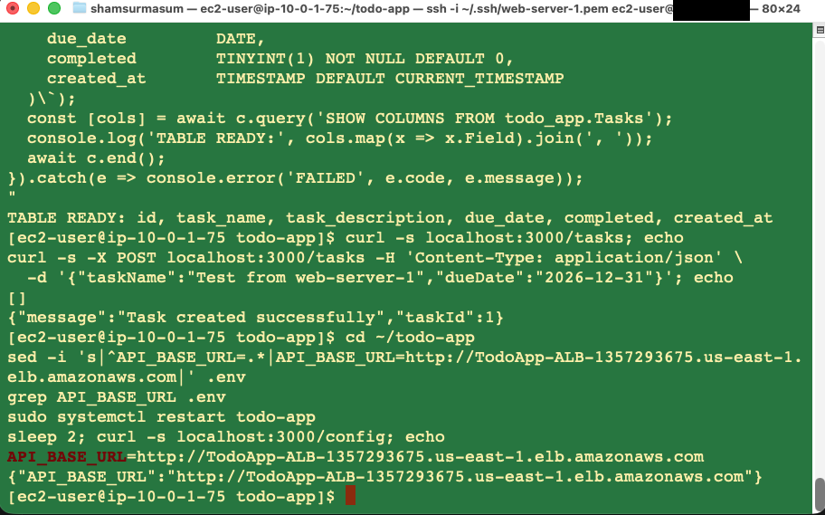

**web-server-2:**

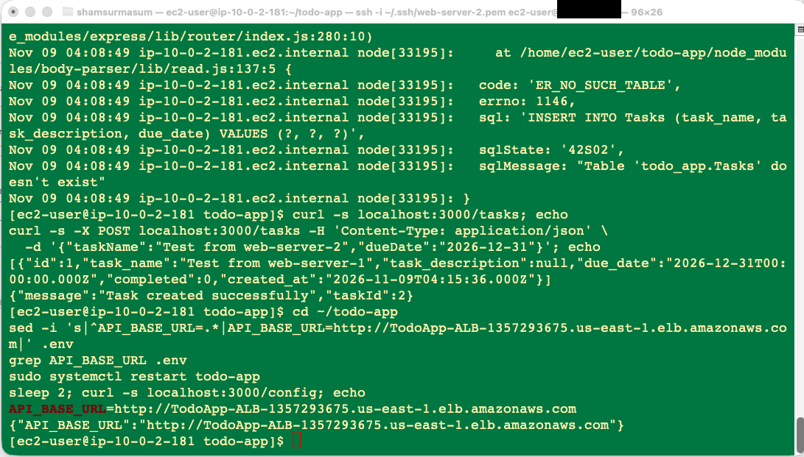

The frontend reads `API_BASE_URL` from `/config` and sends all API calls there. The app only reads `.env` at startup, so always restart the service after editing it. If you skip this, the page loads through the ALB but shows an empty list and **Add Task** does nothing, because the browser calls `localhost:3000` on your own machine. See [troubleshooting.md → Page loads but the list is empty and Add Task does nothing](troubleshooting.md#page-loads-but-the-list-is-empty-and-add-task-does-nothing).

Check from your own machine. Both targets should return the ALB URL, so run it a few times:

```bash
for i in 1 2 3 4; do curl -s http://TodoApp-ALB-1357293675.us-east-1.elb.amazonaws.com/config; echo; done
```

## 4. Test it

1. In **Target Groups → TodoApp-TG → Targets**, wait until both instances are **Healthy**, one in each AZ.

   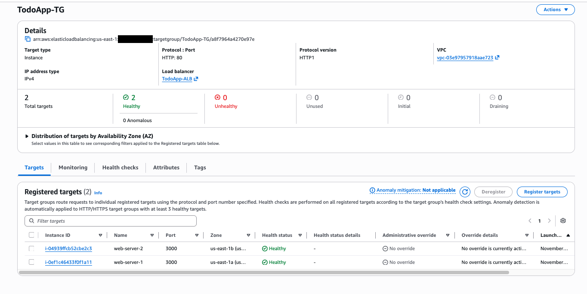

   The ALB's **Resource map** tab shows the whole path: listener `HTTP:80` → default rule → `TodoApp-TG` → both instances on port `3000`, **Healthy**.

   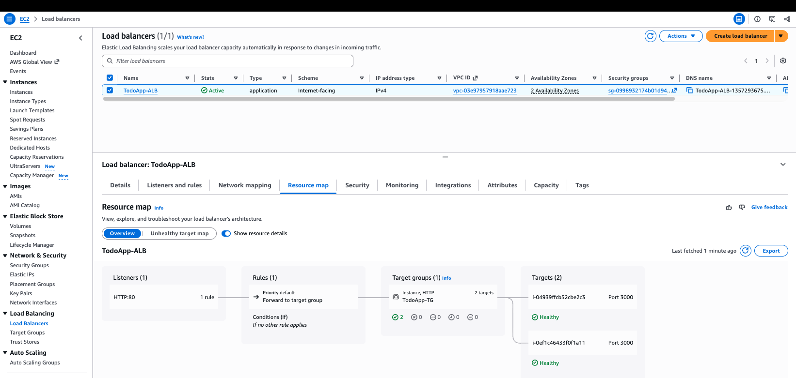

2. Open `http://TodoApp-ALB-1357293675.us-east-1.elb.amazonaws.com` in a browser. Use `http://`: there's no HTTPS listener, so the browser shows **Not Secure**. Hard-refresh with **Cmd+Shift+R** (macOS) or **Ctrl+Shift+R**.

   The two tasks created on the servers in [setup-ec2.md](setup-ec2.md#38-test-on-the-instance) appear, which shows the ALB, both web servers and the shared database working together.

   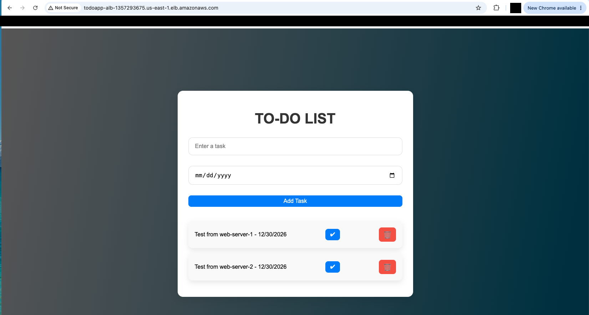

3. Add a task, mark one complete (✔) and delete one (🗑). Here **Test via ALB** was added and marked complete (green, struck through):

   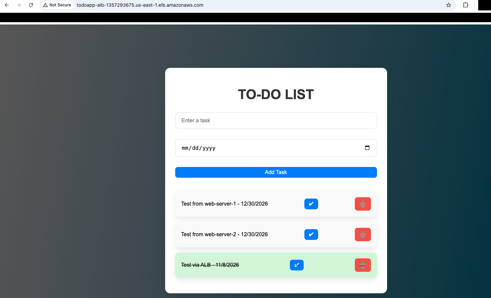

   The due dates show one day early (`12/30/2026` for `2026-12-31`). That's a display bug in the app, not the infrastructure. See [troubleshooting.md → Due dates show one day early](troubleshooting.md#due-dates-show-one-day-early).

4. Test the API directly:

   ```bash
   curl http://TodoApp-ALB-1357293675.us-east-1.elb.amazonaws.com/tasks
   ```

## 5. Test high availability

Stop the **app** rather than the instance. Stopping the instance gives it a new public IP when it starts again.

1. On `web-server-1`:

   ```bash
   sudo systemctl stop todo-app
   ```

2. Within about 20 seconds (two failed checks, 10 seconds apart), **Targets** shows `web-server-1` as **Unhealthy** and `web-server-2` as **Healthy**. With the **Health status = healthy** filter, only `web-server-2` is left:

   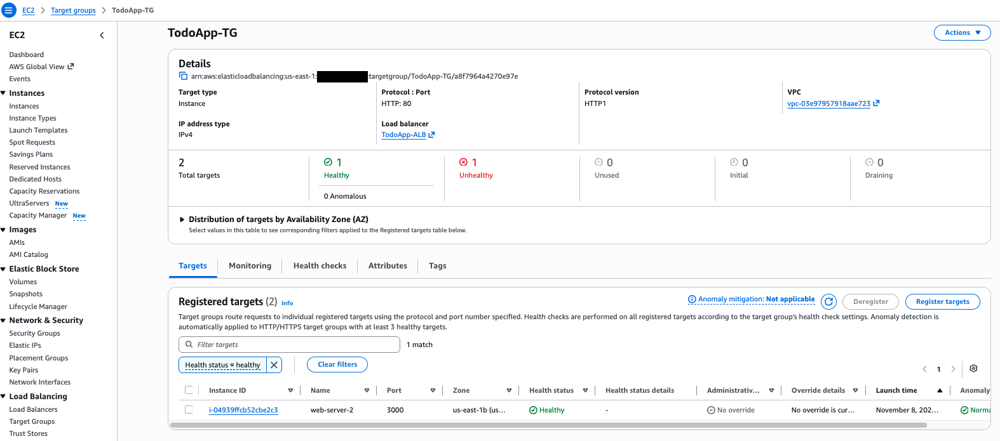

3. Refresh the app and add a task. It still works and the existing tasks are still there, because the ALB sends traffic only to `web-server-2` and both instances share the same RDS database. Here **Added while server 1 down** was created while `web-server-1` was out:

   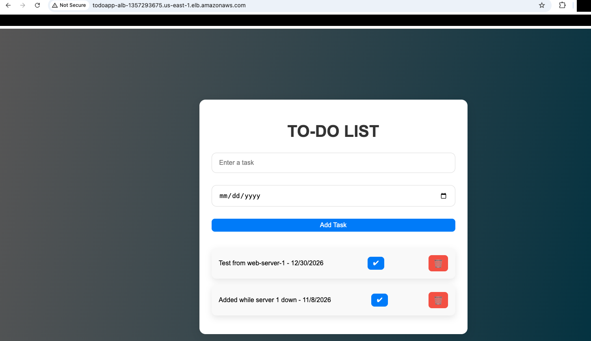

4. Start the app again. After about 20 seconds both targets are **Healthy** again.

   ```bash
   sudo systemctl start todo-app
   ```

   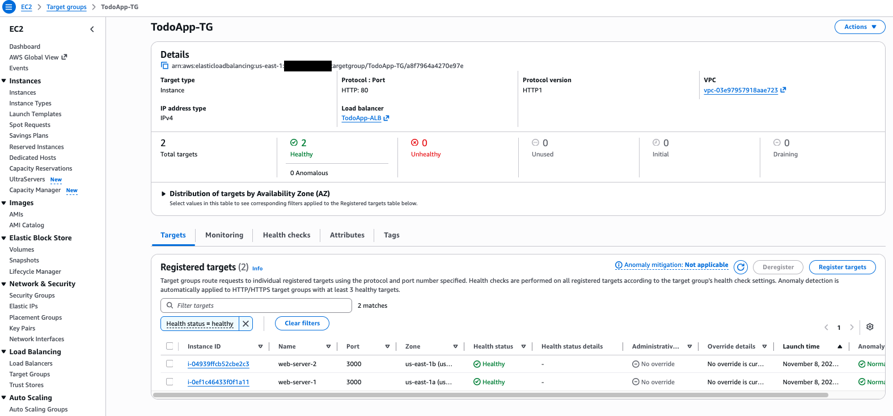

## Next steps (optional)

- Add an **HTTPS** listener on `443` with an ACM certificate, and redirect `80` to `443`.
- Replace the two instances with an **Auto Scaling group** that uses a launch template.
- Move the instances to private subnets with a NAT Gateway, so only the ALB is public.
- Store the database password in **Secrets Manager** instead of `.env`.

## Next step

When you're finished with the lab, [delete all the resources](teardown.md).
