# Set up the web servers (EC2)

You launch two identical instances, one in each public subnet, connect them to the RDS database from [setup-rds.md](setup-rds.md), and run the app on port `3000` as a systemd service.

Before you start, have the RDS **endpoint** and **master password** ready. See [setup-rds.md → Check the database](setup-rds.md#3-check-the-database).

If something doesn't match, see [troubleshooting.md](troubleshooting.md).

## 1. Create the IAM role

1. Open the **IAM** console and go to **Roles → Create role**.
2. **Trusted entity:** AWS service → **EC2**.
3. Attach the policy `AmazonSSMManagedInstanceCore`.
4. Name it `TodoApp-EC2-Role`.

This role lets you open a shell on the instances through **Session Manager**, a fallback that works from any network if SSH is blocked by an IP change.

Creating an EC2 role in the console also creates an **instance profile** with the same name. That's what you select when launching an instance.

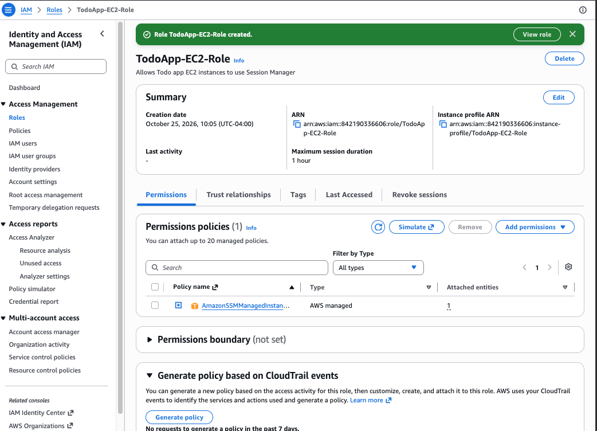

If an instance is already running without the role, select it and choose **Actions → Security → Modify IAM role**. See [troubleshooting.md → Instance launched without the IAM role](troubleshooting.md#instance-launched-without-the-iam-role).

## 2. Launch the instances

In the **EC2** console, choose **Launch instances** and create the first instance:

| Setting | Value |
|---|---|
| Name | `web-server-1` |
| AMI | Amazon Linux 2023 (64-bit x86) |
| Instance type | `t3.micro` |
| Key pair | `web-server-1` (or **Create new key pair**: RSA, `.pem`) |
| Network settings → **Edit** | VPC `TodoAppVPC`, subnet `TodoApp-Subnet-Public-A`, auto-assign public IP **Enable** |
| Firewall | **Select existing security group** → `ToDoApp-Webserver-SG` |
| Storage | Default 8 GiB gp3 |
| IAM instance profile (under **Advanced details**) | `TodoApp-EC2-Role` |

Repeat for `web-server-2` with key pair `web-server-2` and subnet `TodoApp-Subnet-Public-B`.

Wait until both show **Running** and **3/3 checks passed**, one in each Availability Zone:

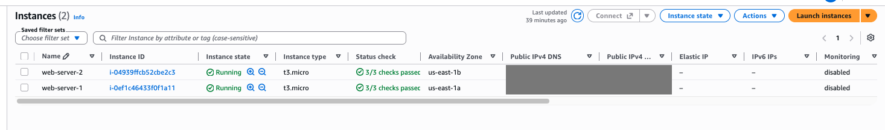

### Check each instance

| Instance | ID | Subnet | AZ | Private IP |
|---|---|---|---|---|
| `web-server-1` | `i-0ef1c46433f0f1a11` | `TodoApp-Subnet-Public-A` (`10.0.1.0/24`) | `us-east-1a` | `10.0.1.75` |
| `web-server-2` | `i-04939ffcb52cbe2c3` | `TodoApp-Subnet-Public-B` (`10.0.2.0/24`) | `us-east-1b` | `10.0.2.181` |

On the **Details** tab, check the VPC, the subnet, the IAM role `TodoApp-EC2-Role`, and that the instance has a public IPv4 address. Because DNS hostnames are on in the VPC, each instance also gets a public DNS name (`ec2-…compute-1.amazonaws.com`).

**web-server-1**: `TodoApp-Subnet-Public-A`, private IP `10.0.1.75`.

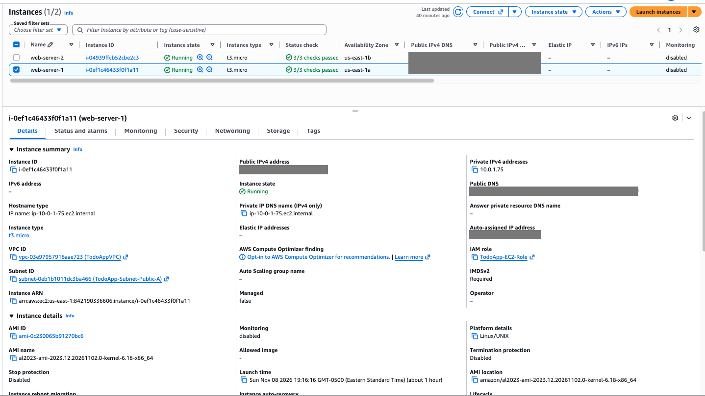

**web-server-2**: `TodoApp-Subnet-Public-B`, private IP `10.0.2.181`.

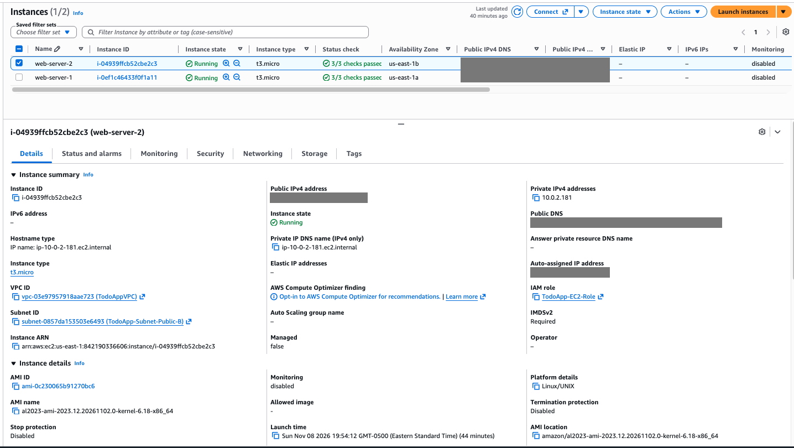

On the **Security** tab, check the IAM role and the security group `ToDoApp-Webserver-SG`, with TCP `3000` from the ALB's security group and SSH `22` from your IP only.

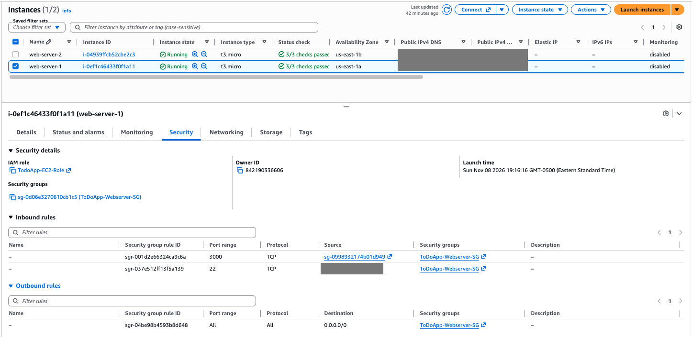

**web-server-2** uses the same role and security group:

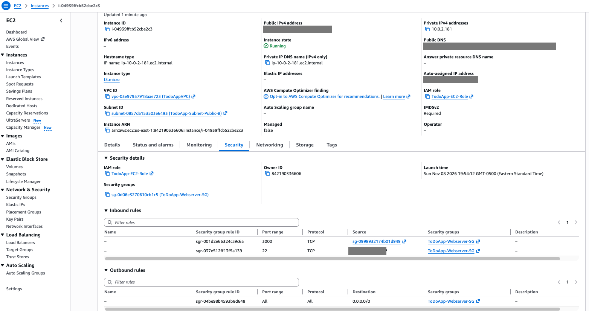

## 3. Install and run the app

Do all of these steps on **both** instances.

### 3.1 Connect

```bash
chmod 400 ~/.ssh/web-server-1.pem
ssh -i ~/.ssh/web-server-1.pem ec2-user@<instance-public-ip>
```

Use `web-server-2.pem` for `web-server-2`. The prompt changes to `[ec2-user@ip-10-0-x-x ~]$`. The "post-quantum key exchange" warning and the "newer release of Amazon Linux" message are harmless.

- `Permission denied (publickey)`: the key file permissions are too open, or you used the other server's key. See [troubleshooting.md → SSH: Permission denied (publickey)](troubleshooting.md#ssh-permission-denied-publickey).
- `Operation timed out`: your public IP has probably changed. See [troubleshooting.md → SSH: Operation timed out](troubleshooting.md#ssh-operation-timed-out).

Either way, you can also use **Connect → Session Manager → Connect**, then run `sudo su - ec2-user`.

### 3.2 Install Node.js and tools

```bash
sudo dnf install -y nodejs git nano
node -v
```

### 3.3 Clone the app and install dependencies

```bash
git clone https://github.com/masumshamsur/Project-ToDoApp.git ~/todo-app
cd ~/todo-app
npm install --omit=dev
ls
```

The app code lives in its own public repo, [masumshamsur/Project-ToDoApp](https://github.com/masumshamsur/Project-ToDoApp), so the clone holds just this project at the top level. `.env` is git-ignored, so the database password never goes to GitHub.

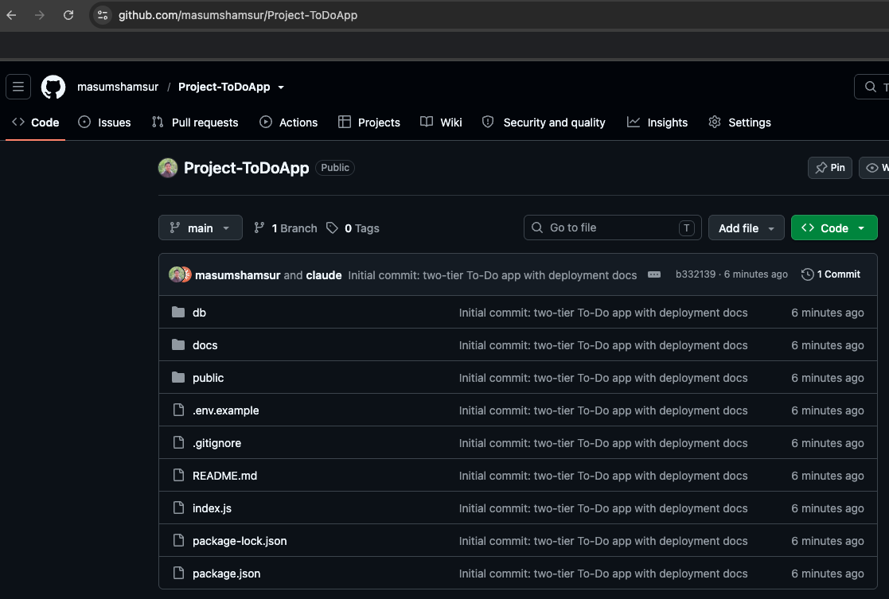

There's no `todo-app` folder in the repo. The last argument of `git clone` names the folder to create on the instance, so `~/todo-app` (`/home/ec2-user/todo-app`) ends up holding the repo's files. Without that argument, git would name the folder after the repo (`~/Project-ToDoApp`). Use `~/todo-app`, because the systemd service (`WorkingDirectory`), the `.env` path and the update commands all expect it.

### 3.4 Create `.env`

```bash
cat > ~/todo-app/.env <<'EOF'
DB_HOST=todo-db-instance.<id>.us-east-1.rds.amazonaws.com
DB_USER=admin
DB_PASSWORD=change-me
DB_NAME=todo_app
API_BASE_URL=http://localhost:3000
EOF
chmod 600 ~/todo-app/.env
nano ~/todo-app/.env
```

- Set `DB_HOST` to your RDS endpoint (in this build, `todo-db-instance.cmz0eoi66au7.us-east-1.rds.amazonaws.com`).
- In nano, replace `change-me` with the RDS master password. Typing it in the editor keeps it out of your shell history. Save with **Ctrl+O**, **Enter**, then exit with **Ctrl+X**.

`chmod 600` makes the file readable only by `ec2-user`. `API_BASE_URL` stays `http://localhost:3000` for now. You change it to the load balancer's address in [setup-alb.md](setup-alb.md#3-point-the-app-at-the-alb).

### 3.5 Test the database connection (both instances)

This uses the app's own `mysql2` driver, so you don't need a MySQL client:

```bash
cd ~/todo-app
node -e "
require('dotenv').config();
require('mysql2/promise').createConnection({
  host: process.env.DB_HOST, user: process.env.DB_USER, password: process.env.DB_PASSWORD
}).then(async c => {
  const [r] = await c.query('SELECT VERSION() AS version, @@require_secure_transport AS tls_required');
  console.log('CONNECTED', r[0]);
  await c.end();
}).catch(e => console.error('FAILED', e.code, e.message));
"
```

| Result | Meaning |
|---|---|
| `CONNECTED { version: '8.4.x', tls_required: 0 }` | Ready |
| `CONNECTED ... tls_required: 1` | RDS requires TLS. See [troubleshooting.md](troubleshooting.md#rds-requires-tls) |
| `FAILED ETIMEDOUT` | `ToDoApp-Database-SG` doesn't allow `3306` from `ToDoApp-Webserver-SG`, or the DB is in another VPC |
| `FAILED ENOTFOUND` | `DB_HOST` is wrong, or still the `<id>` placeholder |
| `FAILED ER_ACCESS_DENIED_ERROR` | Wrong user or password in `.env` |

To check `.env` without showing the password, run `grep -v PASSWORD ~/todo-app/.env`. Both servers connect to MySQL `8.4.11`, and TLS isn't required:

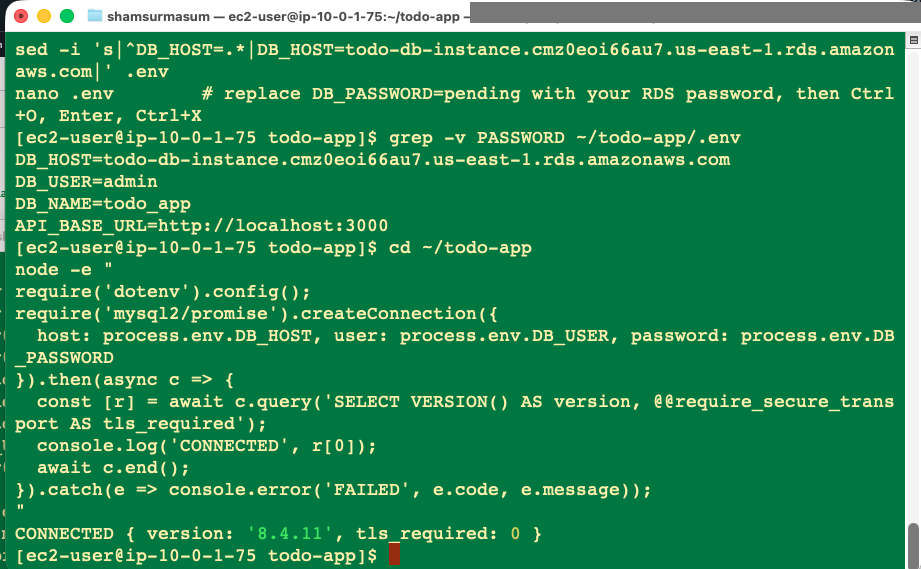

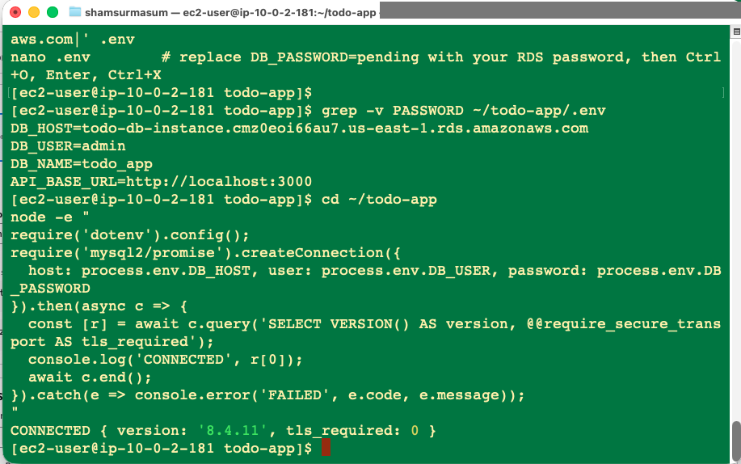

### 3.6 Create the schema (one instance only)

Both instances share the same database, so run this on **one** of them:

> **Don't skip this step.** The connection test above passes even when the table doesn't exist, but `/tasks` then fails with `Could not fetch tasks`. See [troubleshooting.md](troubleshooting.md#tasks-returns-could-not-fetch-tasks-run-2).

```bash
cd ~/todo-app
node -e "
require('dotenv').config();
require('mysql2/promise').createConnection({
  host: process.env.DB_HOST, user: process.env.DB_USER, password: process.env.DB_PASSWORD
}).then(async c => {
  await c.query('CREATE DATABASE IF NOT EXISTS todo_app');
  await c.query(\`CREATE TABLE IF NOT EXISTS todo_app.Tasks (
    id               INT AUTO_INCREMENT PRIMARY KEY,
    task_name        VARCHAR(255) NOT NULL,
    task_description TEXT,
    due_date         DATE,
    completed        TINYINT(1) NOT NULL DEFAULT 0,
    created_at       TIMESTAMP DEFAULT CURRENT_TIMESTAMP
  )\`);
  const [cols] = await c.query('SHOW COLUMNS FROM todo_app.Tasks');
  console.log('TABLE READY:', cols.map(x => x.Field).join(', '));
  await c.end();
}).catch(e => console.error('FAILED', e.code, e.message));
"
```

It should print `TABLE READY: id, task_name, task_description, due_date, completed, created_at`. This is the same SQL as [db/schema.sql](../db/schema.sql). It creates the `Tasks` table that `index.js` queries:

| Column | Type | Notes |
|---|---|---|
| `id` | `INT AUTO_INCREMENT` | Primary key |
| `task_name` | `VARCHAR(255)` | Required |
| `task_description` | `TEXT` | Optional |
| `due_date` | `DATE` | Optional |
| `completed` | `TINYINT(1)` | `0` or `1`, default `0` |
| `created_at` | `TIMESTAMP` | Set automatically |

### 3.7 Run the app as a systemd service

```bash
NODE_BIN=$(which node)
sudo tee /etc/systemd/system/todo-app.service > /dev/null <<EOF
[Unit]
Description=To-Do App
After=network.target

[Service]
WorkingDirectory=/home/ec2-user/todo-app
ExecStart=$NODE_BIN index.js
Restart=always
User=ec2-user

[Install]
WantedBy=multi-user.target
EOF
sudo systemctl daemon-reload
sudo systemctl enable --now todo-app
sudo systemctl status todo-app --no-pager
```

`enable` starts the app automatically when the instance boots, and `Restart=always` restarts it if it crashes.

### 3.8 Test on the instance

**The app is running.** On both instances:

```bash
curl -s -o /dev/null -w 'Homepage HTTP %{http_code}\n' localhost:3000/
curl -s localhost:3000/config; echo
```

Expect `Homepage HTTP 200` and `{"API_BASE_URL":"http://localhost:3000"}`.

**web-server-1:** the service is `active (running)` (the log shows `Server running on port 3000`), and both tests pass.

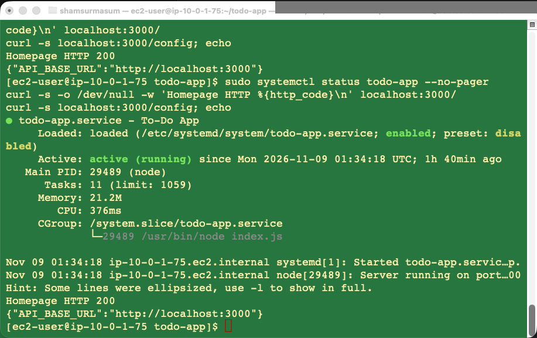

**web-server-2:** the same.

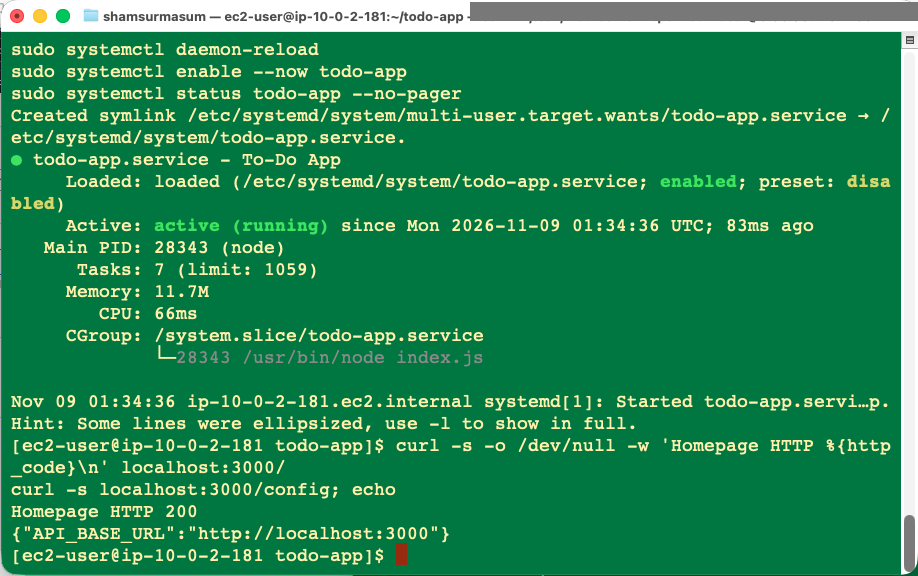

**The app reads and writes the database.** Run this on web-server-1 first, then on web-server-2, changing the task name:

```bash
curl -s localhost:3000/tasks; echo
curl -s -X POST localhost:3000/tasks -H 'Content-Type: application/json' \
  -d '{"taskName":"Test from web-server-1","dueDate":"2026-12-31"}'; echo
```

Expect a JSON list and `Task created successfully`. If you get `Could not fetch tasks`, the table is missing. Run [3.6](#36-create-the-schema-one-instance-only).

**web-server-1:** after `TABLE READY`, the list starts empty (`[]`) and task 1 is created.

![web-server-1: TABLE READY with all six columns, GET /tasks returns [], POST creates taskId 1](images/r2-22-schema-and-tasks-ws1.png)

**web-server-2:** the first `GET /tasks` already returns "Test from web-server-1", which proves both servers share the same RDS database. Its own task becomes task 2. The log lines above it are from an earlier attempt, before the table existed.

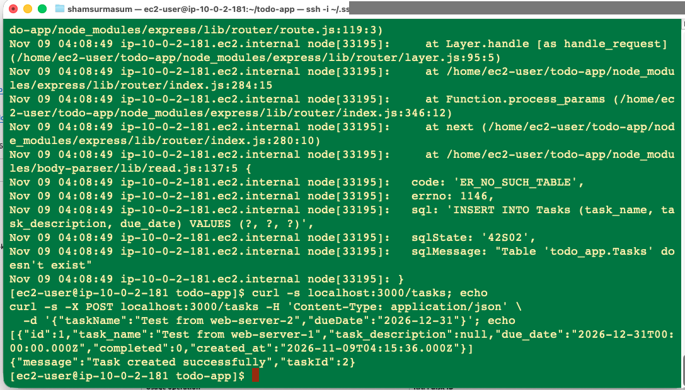

> **Changed `.env`?** The app reads `.env` only at startup, so run `sudo systemctl restart todo-app` after editing it.

## Viewing logs

```bash
journalctl -u todo-app -f
```

## Updating the code

```bash
cd ~/todo-app && git pull
npm install --omit=dev
sudo systemctl restart todo-app
```

Run this on both instances.

## Next step

[Create the Application Load Balancer](setup-alb.md).
