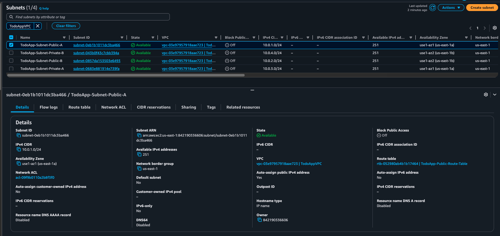
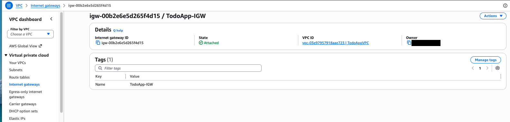
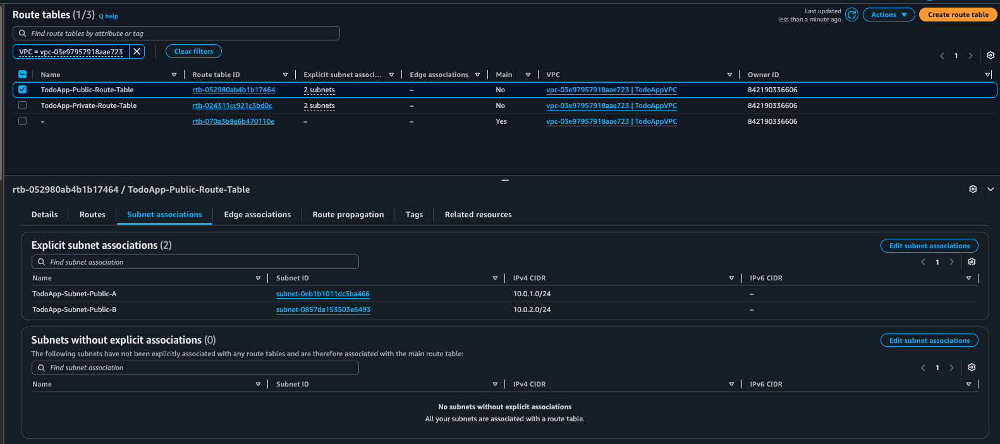
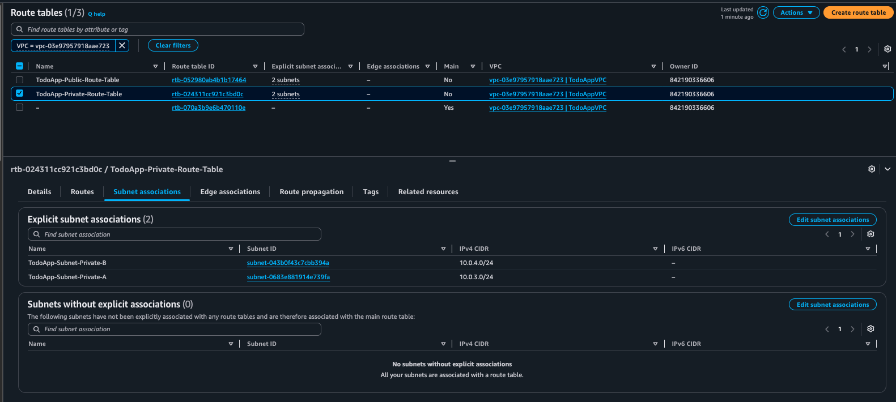
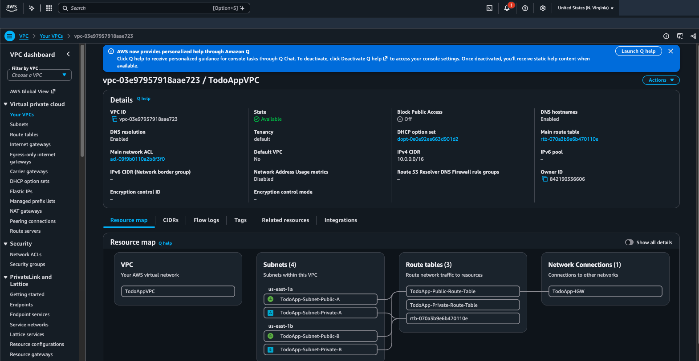
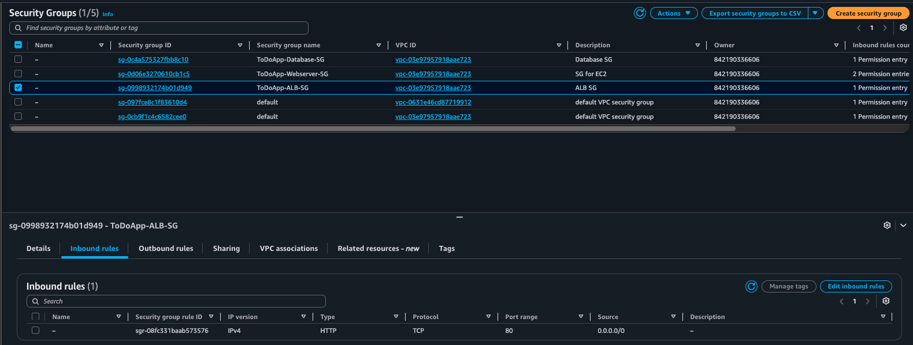
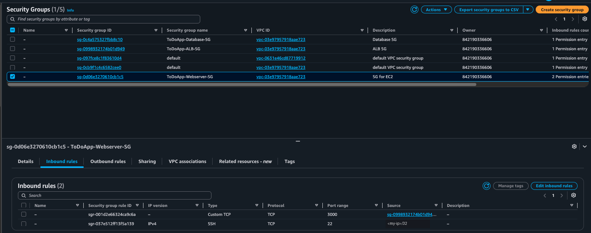

# Set up the network (VPC, subnets, route tables, security groups)

This guide creates the network that every other component runs in. Use the same Region (`us-east-1`) throughout the project.

If something doesn't match, see [troubleshooting.md](troubleshooting.md).

## 1. Create the VPC and subnets

1. Open the **VPC** console, go to **Your VPCs** and choose **Create VPC**.
2. Choose **VPC only**:
   - **Name:** `TodoAppVPC`
   - **IPv4 CIDR:** `10.0.0.0/16`
   - **IPv6 CIDR block:** none
   - **Tenancy:** Default
3. Select the VPC, choose **Actions → Edit VPC settings**, check **Enable DNS hostnames** and save.

   The VPC **Details** panel should show **DNS resolution: Enabled** and **DNS hostnames: Enabled** (see the screenshot in [4. Check the VPC](#4-check-the-vpc)).

   > **Why enable DNS hostnames?** A VPC has two DNS settings:
   >
   > - **DNS resolution** (on by default) lets resources in the VPC look up names through the Amazon DNS server. The web servers need it to turn the RDS endpoint (`todo-instance-lab5.<id>.us-east-1.rds.amazonaws.com`) into the database's private IP.
   > - **DNS hostnames** (off by default in a VPC you create yourself) gives instances DNS names, such as `ec2-3-91-204-88.compute-1.amazonaws.com` for an instance with a public IP.
   >
   > Turning on DNS hostnames makes your VPC behave like the default VPC. Several AWS features need both settings on:
   >
   > - an RDS instance with **Public access: Yes**
   > - **interface VPC endpoints with private DNS**, such as the SSM endpoints Session Manager would need if the web servers moved to private subnets
   > - Route 53 **private hosted zones**
   >
   > This build would still work without it, because the app reaches RDS through DNS resolution. Turn it on anyway, so you don't hit these limits later.

4. Go to **Subnets → Create subnet** and select `TodoAppVPC`. Fill in the first subnet, then choose **Add new subnet** for each of the others. The CIDRs match the architecture diagram:

   | Name | Availability Zone | CIDR |
   |---|---|---|
   | `TodoApp-Subnet-Public-A` | `us-east-1a` | `10.0.1.0/24` |
   | `TodoApp-Subnet-Public-B` | `us-east-1b` | `10.0.2.0/24` |
   | `TodoApp-Subnet-Private-A` | `us-east-1a` | `10.0.3.0/24` |
   | `TodoApp-Subnet-Private-B` | `us-east-1b` | `10.0.4.0/24` |

   

5. For each **public** subnet, choose **Actions → Edit subnet settings**, enable **Auto-assign public IPv4 address** and save. Leave this off for the private subnets.

   > **Why auto-assign a public IPv4 address?** The route `0.0.0.0/0 → IGW` alone doesn't put an instance on the internet. The internet gateway only translates between an instance's private IP and a **public IP**, so an instance without a public IP can't reach the internet or be reached from it, even in a public subnet.
   >
   > The web servers need internet access for:
   >
   > - **SSH** from your computer
   > - **Installing software**: `dnf install nodejs`, `git clone` from GitHub and `npm install` all download from the internet
   > - **Session Manager**: the SSM agent on the instance connects out to the AWS Systems Manager service
   >
   > With this setting on, every instance launched in the subnet gets a public IP automatically, so you can't forget to turn it on in the launch wizard.
   >
   > Leave it **off** for the private subnets. The database should never have a public IP, and the private route table has no route to the internet anyway. The ALB doesn't depend on this setting either, because it gets its own public IPs.
   >
   > **Good to know:**
   > - A public IP changes when you stop and start the instance. Use an Elastic IP if you need a fixed one.
   > - AWS charges about $0.005 per hour (around $3.60 a month) for each public IPv4 address. The free tier covers 750 hours a month for the first 12 months.

## 2. Create the Internet Gateway

1. Go to **Internet gateways → Create internet gateway** and name it `TodoApp-IGW`.
2. Choose **Actions → Attach to VPC** and select `TodoAppVPC`.

The **State** should be **Attached**, with **VPC ID** `TodoAppVPC`:



## 3. Create the route tables

**Public route table**

1. **Route tables → Create route table**: name `TodoApp-Public-Route-Table`, VPC `TodoAppVPC`.
2. **Routes → Edit routes → Add route**: destination `0.0.0.0/0`, target **Internet Gateway → `TodoApp-IGW`**.
3. **Subnet associations → Edit subnet associations**: select both public subnets.



**Private route table**

1. Create `TodoApp-Private-Route-Table` in `TodoAppVPC`.
2. Leave the routes as they are (only `10.0.0.0/16 → local`).
3. Associate both private subnets.



With no route to the internet, nothing outside the VPC can reach the database.

## 4. Check the VPC

Open `TodoAppVPC`. In **Details**, check:
- **IPv4 CIDR** is `10.0.0.0/16`
- **DNS resolution** and **DNS hostnames** are both **Enabled**

Then open the **Resource map** tab. It should show:
- the four subnets, each wired to the correct route table
- the public route table connected to `TodoApp-IGW`

The third route table (`rtb-...` with no name) is the VPC's main route table, which AWS creates automatically. No subnet uses it.



## 5. Create the security groups

Go to **VPC → Security → Security groups** (or **EC2 → Network & Security → Security Groups**) and choose **Create security group**. Create all three groups in `TodoAppVPC`, in this order, because each one refers to the one before it.

**Inbound rules**

| Name | Inbound rule | Source |
|---|---|---|
| `ToDoApp-ALB-SG` | HTTP, port `80` | **Anywhere-IPv4** `0.0.0.0/0` |
| `ToDoApp-Webserver-SG` | Custom TCP, port `3000` | **Custom** → `ToDoApp-ALB-SG` |
| `ToDoApp-Webserver-SG` | SSH, port `22` | **My IP** |
| `ToDoApp-Database-SG` | MYSQL/Aurora, port `3306` | **Custom** → `ToDoApp-Webserver-SG` |

**Outbound rules**

| Name | Outbound rule | Destination |
|---|---|---|
| `ToDoApp-ALB-SG` | Custom TCP, port `3000` | **Custom** → `ToDoApp-Webserver-SG` |
| `ToDoApp-Webserver-SG` | All traffic (the default) | `0.0.0.0/0` |
| `ToDoApp-Database-SG` | All traffic (the default) | `0.0.0.0/0` |

The ALB's outbound rule points to `ToDoApp-Webserver-SG`, which doesn't exist yet when you create the ALB group. Add it afterwards: once `ToDoApp-Webserver-SG` exists, open **`ToDoApp-ALB-SG` → Outbound rules → Edit outbound rules**, delete the default "All traffic" rule, add Custom TCP `3000` → `ToDoApp-Webserver-SG` and save. Whatever you do, don't leave the ALB group with **no** outbound rule. See [troubleshooting.md → ALB "Reachability may be impacted"](troubleshooting.md#alb-reachability-may-be-impacted-no-outbound-rule-run-2).

### How the rules fit together

Every request in this app passes through three hops, and each hop is a **new connection** started by the tier on the left:

```
Browser ──80──▶ ALB ──3000──▶ Web servers ──3306──▶ RDS
  (internet)  ALB-SG        Webserver-SG          Database-SG

Your laptop ──22──▶ Web servers           (SSH, for you only)
Web servers ──443/80──▶ internet          (dnf, git, npm, Session Manager)
```

Two ideas explain every rule below.

- **Security groups are stateful.** A rule only has to allow the side that **starts** a connection. The replies on that connection are always let back through, in both directions, without a matching rule. So the ALB needs an *outbound* rule to reach the web servers, but the web servers don't need an outbound rule to answer it.
- **Traffic between two security groups must be allowed on both ends.** The sender's **outbound** rule must let it leave, and the receiver's **inbound** rule must let it in. Each hop above is therefore a pair of rules.

**Why use a security group as the source or destination?** A rule like "from `ToDoApp-ALB-SG`" means "from any network interface that has this group attached", not a fixed address. It's the best choice here:

- **`0.0.0.0/0`** would allow any address on the internet, far more than needed.
- **Private IPs** (`10.0.1.75/32`) break as soon as an instance or ALB node is replaced, because its IP changes. The ALB's own IPs change all the time.
- **A security group** always matches exactly the right resources, including a new `web-server-3` or instances started by Auto Scaling later, with no edits.

This is the **least privilege** principle: allow exactly the traffic the design needs, and nothing more.

#### `ToDoApp-ALB-SG` (the load balancer)

| Direction | Rule | Why |
|---|---|---|
| Inbound | HTTP `80` from `0.0.0.0/0` | The ALB is the app's **only public entry point**, so anyone on the internet must be able to open the page. The listener is HTTP on port 80, so that's the only port opened. There's no SSH, because the ALB is a managed service, not a server you log in to. |
| Outbound | TCP `3000` to `ToDoApp-Webserver-SG` | The ALB opens a **new** connection to a web server for every request it forwards, and for a **health check** every 10 seconds. The app listens on 3000, and the web servers are the only place the ALB ever sends traffic, so that's all it's allowed to reach. Replies to browsers need no outbound rule, because those connections were started from outside. |

#### `ToDoApp-Webserver-SG` (the EC2 instances)

| Direction | Rule | Why |
|---|---|---|
| Inbound | TCP `3000` from `ToDoApp-ALB-SG` | This is the receiving half of the ALB's outbound rule. Only the load balancer can reach the app. The instances have public IPs, but `http://<public-ip>:3000` from the internet is blocked, so users can't bypass the ALB and its health checks and failover. |
| Inbound | SSH `22` from **My IP** | For you to log in and set up the app. **My IP** fills in your current public IP as a `/32`, so only your machine can try to connect. Never use `0.0.0.0/0` for SSH. The rule is optional: without it, use Session Manager. |
| Outbound | All traffic to `0.0.0.0/0` | The web servers start connections to several places: **RDS** on `3306`, the **internet** on `443`/`80` for `dnf install`, `git clone` and `npm install`, and the **Systems Manager** service on `443` for Session Manager. Replies to the ALB and to SSH need no rule, because of statefulness. You could narrow this to `3306` → `ToDoApp-Database-SG` plus `443` and `80` → `0.0.0.0/0`, but the default is common for servers that install software. |

#### `ToDoApp-Database-SG` (RDS)

| Direction | Rule | Why |
|---|---|---|
| Inbound | MYSQL/Aurora `3306` from `ToDoApp-Webserver-SG` | This is the receiving half of the web servers' outbound traffic to the database. Only the app instances can open a MySQL connection. Nothing else, not even the ALB or your laptop, can reach the database. |
| Outbound | All traffic (the default) | RDS never **starts** connections in this design. It only answers the web servers, and those replies are allowed by statefulness. The rule is effectively unused. It's also harmless, because the private subnets have no route to the internet. You could delete it for the tightest setup. |

If your IP changes (new network, VPN), edit the SSH rule and select **My IP** again.

Check each group's **Inbound rules** and **Outbound rules** tabs:

| Security group | ID | Inbound rules | Outbound rules |
|---|---|---|---|
| `ToDoApp-ALB-SG` | `sg-0998932174b01d949` | HTTP `80` from `0.0.0.0/0` only | TCP `3000` to `ToDoApp-Webserver-SG` |
| `ToDoApp-Webserver-SG` | `sg-0d06e3270610cb1c5` | Custom TCP `3000` from `ToDoApp-ALB-SG`, SSH `22` from My IP | All traffic |
| `ToDoApp-Database-SG` | `sg-0c4a575327fbb8c10` | MYSQL/Aurora `3306` from `ToDoApp-Webserver-SG` | All traffic |

**`ToDoApp-ALB-SG`**: a single rule, HTTP `80` from anywhere.



**`ToDoApp-Webserver-SG`**: TCP `3000` from `ToDoApp-ALB-SG` (`sg-0998932174b01d949`), and SSH `22` from your IP only.



> **Common mistake:** opening SSH, HTTP and MySQL on `ToDoApp-Webserver-SG` to `0.0.0.0/0`. Another is putting the SSH rule on `ToDoApp-ALB-SG` instead of the web server group. See [troubleshooting.md → Web server security group open to the internet](troubleshooting.md#web-server-security-group-open-to-the-internet) and [SSH rule on the wrong security group](troubleshooting.md#ssh-rule-on-the-wrong-security-group-run-2). A third is deleting every outbound rule from `ToDoApp-ALB-SG`, which leaves the ALB unable to reach the targets. See [ALB "Reachability may be impacted"](troubleshooting.md#alb-reachability-may-be-impacted-no-outbound-rule-run-2).

## Next step

[Create the RDS database](setup-rds.md).
