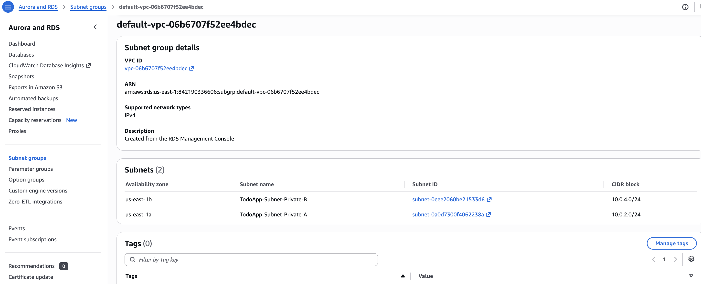
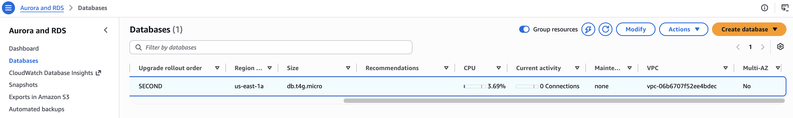
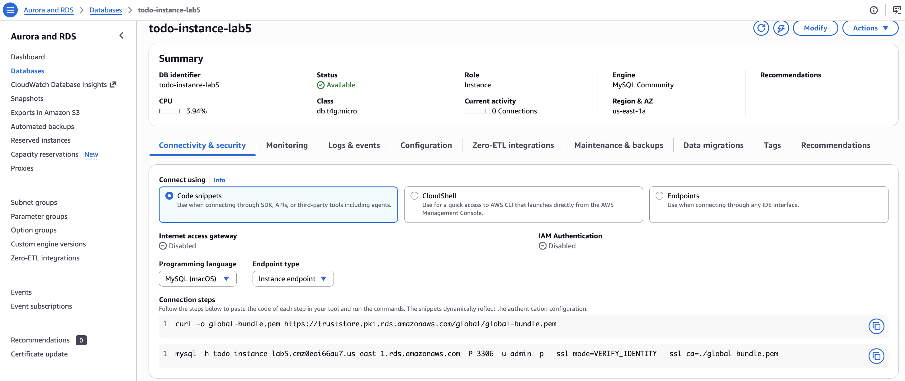
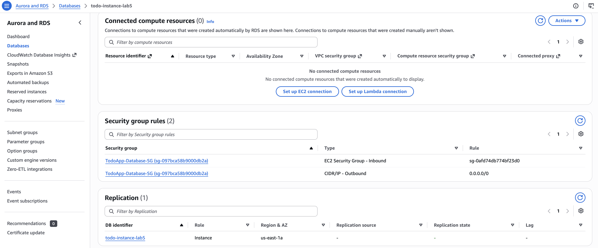

# Set up the RDS MySQL database

The database runs in the private subnets and accepts connections only from the web server security group.

If something doesn't match, see [troubleshooting.md](troubleshooting.md).

## 1. Create a DB subnet group

1. Open the **Aurora and RDS** console and go to **Subnet groups → Create DB subnet group**.
2. Fill in:
   - **Name:** `todoapp-db-subnet-group`
   - **VPC:** `TodoAppVPC`
   - **Availability Zones:** `us-east-1a` and `us-east-1b`
   - **Subnets:** `10.0.2.0/24` (Private-A) and `10.0.4.0/24` (Private-B), the private subnets only

The subnet group should list only the two private subnets:



> **Don't use the auto-created `default-vpc-...` group.** If you skip this step, the RDS console creates a `default-vpc-<id>` subnet group containing **every** subnet in the VPC, public ones included. See [troubleshooting.md → RDS subnet group includes public subnets](troubleshooting.md#rds-subnet-group-includes-public-subnets).

## 2. Create the database

1. Go to **Databases → Create database** and choose **Standard create** (called **Full configuration** in newer consoles).
2. Use these settings:

   | Setting | Value |
   |---|---|
   | Engine | MySQL (default version, 8.4.x; avoid 8.0, which is past standard support and costs extra) |
   | Template | Free tier (or Sandbox / Dev/Test) |
   | DB instance identifier | `todo-instance-lab5` |
   | Master username | `admin` |
   | Credentials management | **Self managed**. Set a strong password and save it |
   | Instance class | `db.t4g.micro` (or `db.t3.micro`) |
   | Storage | 20 GiB gp2/gp3, storage autoscaling off |
   | Availability | Single-AZ (no standby) |
   | Compute resource | Don't connect to an EC2 compute resource |
   | VPC | `TodoAppVPC` |
   | DB subnet group | `todoapp-db-subnet-group` |
   | Public access | **No** |
   | VPC security group | `ToDoApp-Database-SG` (remove `default`) |
   | Monitoring | Enhanced Monitoring and Performance Insights off |
   | Initial database name (under **Additional configuration**) | `todo_app` (optional; the schema step creates it) |

3. Choose **Create database** and wait for the status to become **Available** (about 5–10 minutes).



## 3. Check the database

Open the database and go to **Connectivity & security**. Copy the endpoint from the **Connection steps** snippet (`todo-instance-lab5.<id>.us-east-1.rds.amazonaws.com`). This is your `DB_HOST`. **Internet access gateway** should be **Disabled**.



Scroll down to **Security group rules**. The only inbound rule should allow the web server security group.



> **Console layout:** the redesigned RDS console no longer has a **Networking** section on this tab. Find the subnet group under **Subnet groups** in the sidebar, and the engine version on the **Configuration** tab. See [troubleshooting.md → Can't find the RDS networking details](troubleshooting.md#cant-find-the-rds-networking-details).

To confirm the database is private and see which subnet it's in, resolve its endpoint from any machine. It should return a **private** `10.0.x.x` address:

```bash
dig +short todo-instance-lab5.<id>.us-east-1.rds.amazonaws.com @8.8.8.8
# 10.0.2.246  -> TodoApp-Subnet-Private-A (10.0.2.0/24), not publicly accessible
```

> **Multi-AZ:** for production, enable **Multi-AZ DB instance**, so a standby in the second private subnet takes over if the primary fails. It roughly doubles the cost, so it's optional for this lab.

## 4. Create the schema

You can't reach the database from your computer, because it's in a private subnet. Create the schema from one of the web servers. See [setup-ec2.md → 3.5 Create the schema](setup-ec2.md#35-create-the-schema-one-instance-only). It uses the app's own `mysql2` driver, so you don't need a MySQL client.

[db/schema.sql](../db/schema.sql) creates the `Tasks` table that `index.js` queries:

| Column | Type | Notes |
|---|---|---|
| `id` | `INT AUTO_INCREMENT` | Primary key |
| `task_name` | `VARCHAR(255)` | Required |
| `task_description` | `TEXT` | Optional |
| `due_date` | `DATE` | Optional |
| `completed` | `TINYINT(1)` | `0` or `1`, default `0` |
| `created_at` | `TIMESTAMP` | Set automatically |

## Next step

[Create the Application Load Balancer](setup-alb.md).
