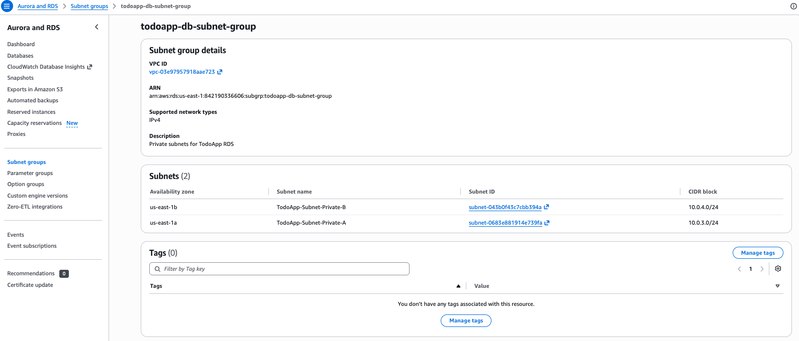
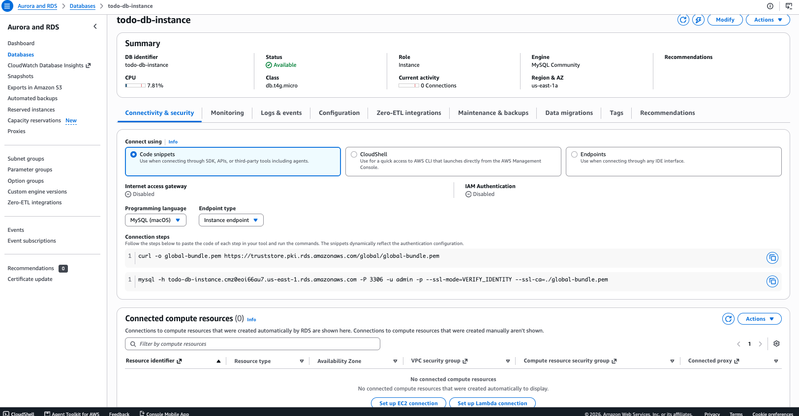

# Set up the RDS MySQL database

The database runs in the private subnets and accepts connections only from the web server security group. You create it before the web servers, so its endpoint is ready when you configure the app.

You can't connect to the database from your computer, because it's private. The connection test and the schema are done from the web servers in [setup-ec2.md](setup-ec2.md#35-test-the-database-connection-both-instances).

If something doesn't match, see [troubleshooting.md](troubleshooting.md).

## 1. Create a DB subnet group

1. Open the **Aurora and RDS** console and go to **Subnet groups → Create DB subnet group**.
2. Fill in:
   - **Name:** `todoapp-db-subnet-group`
   - **Description:** `Private subnets for TodoApp RDS`
   - **VPC:** `TodoAppVPC`
   - **Availability Zones:** `us-east-1a` and `us-east-1b`
   - **Subnets:** `10.0.3.0/24` (`TodoApp-Subnet-Private-A`) and `10.0.4.0/24` (`TodoApp-Subnet-Private-B`), the private subnets only

The subnet group should list only the two private subnets:



> **Don't use the auto-created `default-vpc-...` group.** If you skip this step, the RDS console creates a `default-vpc-<id>` subnet group containing **every** subnet in the VPC, public ones included. See [troubleshooting.md → RDS subnet group includes public subnets](troubleshooting.md#rds-subnet-group-includes-public-subnets).

## 2. Create the database

1. Go to **Databases → Create database** and choose **Standard create** (called **Full configuration** in newer consoles).
2. Use these settings:

   | Setting | Value |
   |---|---|
   | Engine | MySQL (default version, 8.4.x; avoid 8.0, which is past standard support and costs extra) |
   | Template | Free tier (or Sandbox / Dev/Test) |
   | DB instance identifier | `todo-db-instance` |
   | Master username | `admin` |
   | Credentials management | **Self managed**. Set a strong password and save it |
   | Instance class | `db.t4g.micro` (or `db.t3.micro`) |
   | Storage | 20 GiB gp2/gp3, storage autoscaling off |
   | Availability | Single-AZ (no standby) |
   | Compute resource | Don't connect to an EC2 compute resource |
   | VPC | `TodoAppVPC` |
   | DB subnet group | `todoapp-db-subnet-group` |
   | Public access | **No** |
   | VPC security group | `ToDoApp-Database-SG` (remove `default`) |
   | Monitoring | Enhanced Monitoring and Performance Insights off |
   | Initial database name (under **Additional configuration**) | `todo_app` (optional; the schema step creates it) |

3. Choose **Create database** and wait for the status to become **Available** (about 5–10 minutes).

## 3. Check the database

Open the database and go to **Connectivity & security**. The redesigned console has no separate **Endpoint** field. The endpoint is inside the second **Connection steps** snippet, right after `mysql -h`:

```
mysql -h todo-db-instance.cmz0eoi66au7.us-east-1.rds.amazonaws.com -P 3306 -u admin -p ...
         └──────────────────── endpoint = DB_HOST ────────────────┘
```

Copy only the host name, from `todo-db-instance` to `.amazonaws.com`. Don't copy `mysql -h` or the options after it. The port is `3306`. **Internet access gateway** should be **Disabled**, which confirms the database isn't reachable from the internet. Save the endpoint: it becomes `DB_HOST` in the app's `.env`.



You can also choose **Endpoints** under **Connect using** to see the endpoint on its own, or run this from any machine with the AWS CLI:

```bash
aws rds describe-db-instances --db-instance-identifier todo-db-instance \
  --query 'DBInstances[0].Endpoint.Address' --output text
```

Further down, under **Security group rules**, the only inbound rule should allow `ToDoApp-Webserver-SG` on port `3306`. The web servers don't exist yet, but the rule refers to their security group, so it already lets them in once they're launched. In the redesigned console you can also check it under **VPC → Security groups → `ToDoApp-Database-SG` → Inbound rules**.

To confirm the database is private and see which subnet it's in, resolve its endpoint from any machine. It should return a **private** `10.0.x.x` address:

```bash
dig +short todo-db-instance.<id>.us-east-1.rds.amazonaws.com @8.8.8.8
# 10.0.3.x  -> TodoApp-Subnet-Private-A (10.0.3.0/24), not publicly accessible
```

> **Multi-AZ:** for production, enable **Multi-AZ DB instance**, so a standby in the second private subnet takes over if the primary fails. It roughly doubles the cost, so it's optional for this lab.

## Next step

Keep the endpoint and the master password handy. You put them in `.env` on the web servers in the next step.

[Launch the web servers (EC2)](setup-ec2.md).
