# Troubleshooting

Problems we hit while deploying this project, and how each was fixed. The project was built twice:

- **Run 1** was the first build. Its subnet CIDRs didn't match the diagram.
- **Run 2** is the rebuild that matches the diagram, documented in the order network → database → web servers → load balancer.

Entries marked **(Run 2)** come from the rebuild. The others come from Run 1 and still apply if you make the same mistake, so they're kept. Problems that come up often but didn't happen here are listed at the end.

## Run 2 at a glance

| Step | Problem | Cause | Fix |
|---|---|---|---|
| 1 · Network | [SSH rule on the wrong security group](#ssh-rule-on-the-wrong-security-group-run-2) | SSH from My IP was added to `ToDoApp-ALB-SG`, and the web server group allowed SSH from `0.0.0.0/0` | Deleted the ALB SSH rule. Set the web server SSH source to **My IP** |
| 3 · Web servers | [SSH: Permission denied (publickey)](#ssh-permission-denied-publickey) | Key file permissions too open | `chmod 400` on the `.pem` key |
| 2 · Database | Couldn't find the RDS endpoint | The new console shows it only inside the connection snippet | See [setup-rds.md → Check the database](setup-rds.md#3-check-the-database) |
| 3 · Web servers | [`/tasks` returns "Could not fetch tasks"](#tasks-returns-could-not-fetch-tasks-run-2) | `ER_NO_SUCH_TABLE`: the schema step was skipped | Ran the schema script on one server |
| 4 · Load balancer | [Register targets lists no instances](#register-targets-lists-no-instances-run-2) | The list hadn't loaded | Refreshed the page. Both servers appeared |
| 4 · Load balancer | [ALB "Reachability may be impacted"](#alb-reachability-may-be-impacted-no-outbound-rule-run-2) | `ToDoApp-ALB-SG` had **0 outbound rules**, so the ALB couldn't reach the targets | Added outbound TCP `3000` → `ToDoApp-Webserver-SG` |
| 4 · Load balancer | [Due dates show one day early](#due-dates-show-one-day-early) | App bug: a UTC date is shown in local time | Known issue, one-line fix in `public/script.js` |

**Contents**

- Network and security
  - [Subnet CIDRs don't match the diagram](#subnet-cidrs-dont-match-the-diagram)
  - [Web server security group open to the internet](#web-server-security-group-open-to-the-internet)
  - [SSH rule on the wrong security group (Run 2)](#ssh-rule-on-the-wrong-security-group-run-2)
  - [SSH: Permission denied (publickey)](#ssh-permission-denied-publickey)
  - [SSH: Operation timed out](#ssh-operation-timed-out)
- Database
  - [Can't find the RDS networking details](#cant-find-the-rds-networking-details)
  - [RDS subnet group includes public subnets](#rds-subnet-group-includes-public-subnets)
  - [Schema file and MySQL client not on the instance](#schema-file-and-mysql-client-not-on-the-instance)
  - [RDS requires TLS](#rds-requires-tls)
  - [`/tasks` returns "Could not fetch tasks" (Run 2)](#tasks-returns-could-not-fetch-tasks-run-2)
- EC2
  - [Instance launched without the IAM role](#instance-launched-without-the-iam-role)
  - [Extra instance not in the architecture](#extra-instance-not-in-the-architecture)
  - [Harmless messages in the terminal](#harmless-messages-in-the-terminal)
- Load balancer and app
  - [ALB "Reachability may be impacted": no outbound rule (Run 2)](#alb-reachability-may-be-impacted-no-outbound-rule-run-2)
  - [Register targets lists no instances (Run 2)](#register-targets-lists-no-instances-run-2)
  - [Target group shows targets as Unused](#target-group-shows-targets-as-unused)
  - [Page loads but the list is empty and Add Task does nothing](#page-loads-but-the-list-is-empty-and-add-task-does-nothing)
  - [`curl /config` prints nothing after a restart](#curl-config-prints-nothing-after-a-restart)
  - [Due dates show one day early](#due-dates-show-one-day-early)
- [Other common problems](#other-common-problems)
- [Useful diagnostic commands](#useful-diagnostic-commands)

---

## Network and security

### Subnet CIDRs don't match the diagram

**Symptom:** the subnets list shows Public-B as `10.0.3.0/24` and Private-A as `10.0.2.0/24`, but the architecture diagram has them the other way round.

**Cause:** the CIDRs were typed in a different order when the subnets were created.

**Status:** fixed in Run 2. The subnets were recreated with the diagram's CIDRs (Public-A `10.0.1.0/24`, Public-B `10.0.2.0/24`, Private-A `10.0.3.0/24`, Private-B `10.0.4.0/24`). See [setup-network.md](setup-network.md#1-create-the-vpc-and-subnets).

**Why it didn't break anything in Run 1:** a subnet is public or private because of its **route table**, not its CIDR. If you want to match the diagram exactly, delete and recreate the two subnets **before** putting anything in them. You can't change a subnet's CIDR after it's created.

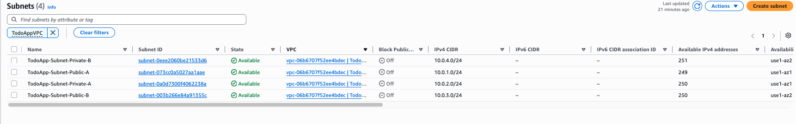

### Web server security group open to the internet

**Symptom:** `ToDoApp-Webserver-SG` allows SSH 22, HTTP 80 and MySQL 3306 from `0.0.0.0/0`.

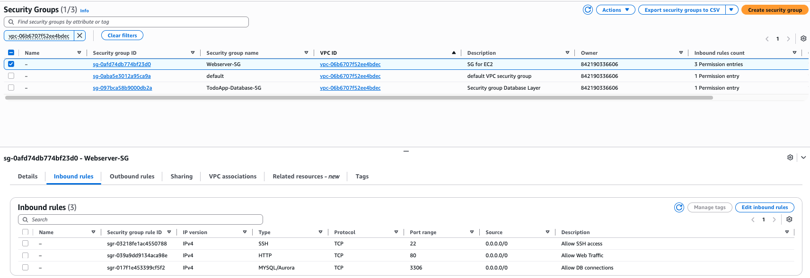

**Why it's wrong:**

| Rule | Problem |
|---|---|
| SSH 22 from `0.0.0.0/0` | Anyone on the internet can attempt to log in |
| HTTP 80 from `0.0.0.0/0` | The app listens on **3000**, not 80, and this lets users bypass the ALB |
| MySQL 3306 from `0.0.0.0/0` | MySQL runs on RDS, not on EC2. The instances only make **outbound** connections to the DB, which the default outbound rule already allows |
| *(missing)* | Nothing allows the ALB to reach port 3000 |

**Fix:**

1. Create `ToDoApp-ALB-SG` first (HTTP 80 from `0.0.0.0/0`).
2. In `ToDoApp-Webserver-SG`, choose **Edit inbound rules**, delete the HTTP 80 and MySQL 3306 rules, change SSH's source to **My IP**, and add **Custom TCP 3000** from `ToDoApp-ALB-SG`.

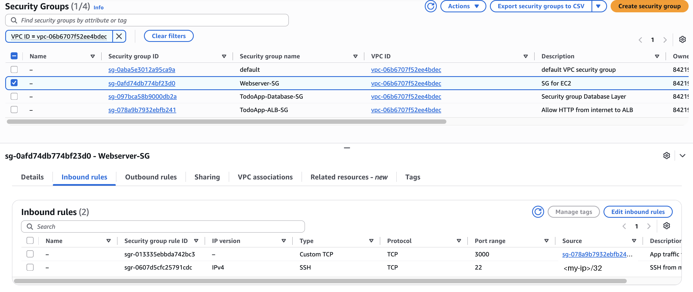

The `default` security group and `ToDoApp-Database-SG` were already correct:

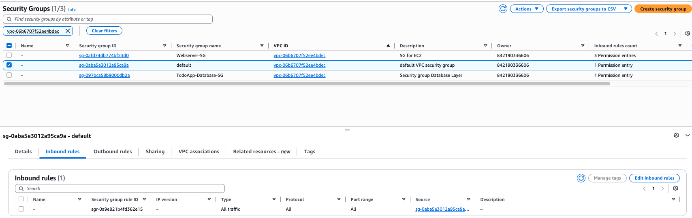

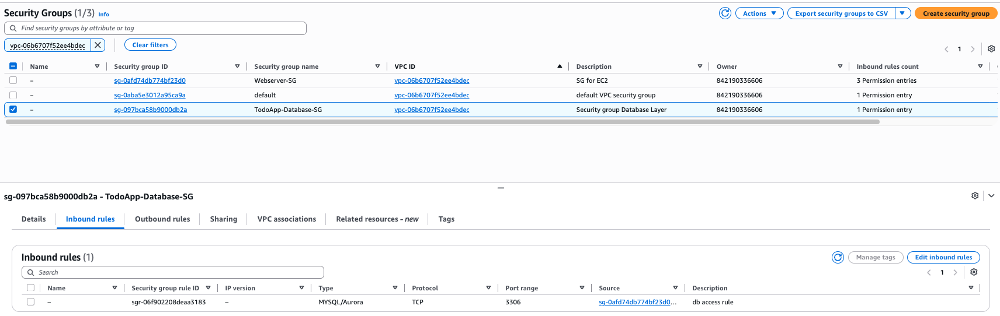

### SSH rule on the wrong security group (Run 2)

**Symptom:** after creating the security groups in Run 2:

| Security group | Rule | Problem |
|---|---|---|
| `ToDoApp-ALB-SG` | SSH `22` from `<my-ip>/32` | The ALB isn't a server you log in to. It only needs HTTP `80` |
| `ToDoApp-Webserver-SG` | SSH `22` from `0.0.0.0/0` | Anyone on the internet can try to log in to the web servers |

**Cause:** the "SSH from My IP" rule was added to the ALB's security group instead of the web servers' group, and the web server rule was left open to the internet.

**Fix:**

1. **VPC → Security groups → `ToDoApp-ALB-SG` → Inbound rules → Edit inbound rules**. Choose **Delete** on the SSH row, then **Save rules**. Only `HTTP 80` from `0.0.0.0/0` remains.
2. **`ToDoApp-Webserver-SG` → Inbound rules → Edit inbound rules**. On the SSH row, change **Source** to **My IP**, then **Save rules**.

After the fix, `ToDoApp-ALB-SG` has only HTTP `80`, and `ToDoApp-Webserver-SG` allows SSH only from your IP:

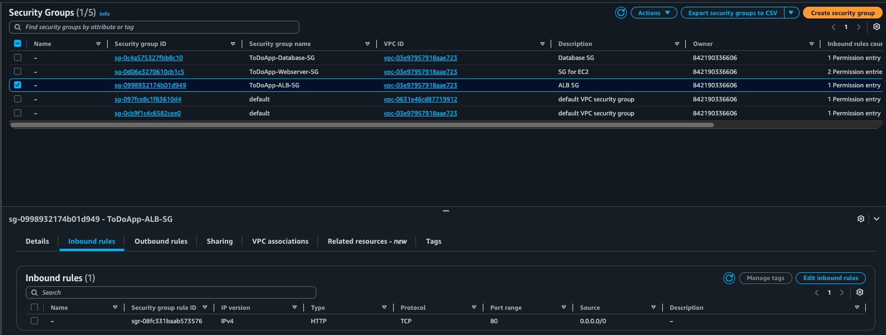

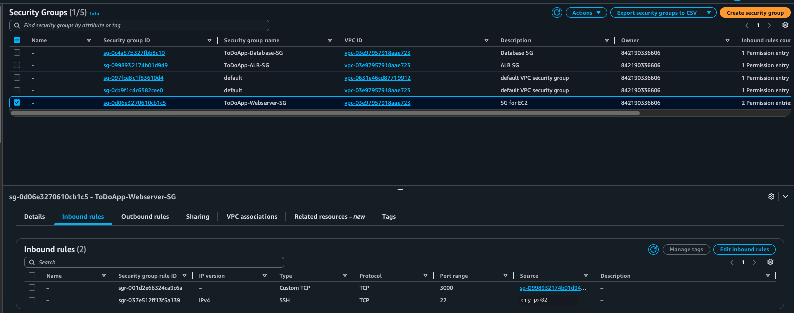

**Rule of thumb:** SSH goes only on the group attached to the instances you log in to, and only from **My IP**.

### SSH: Permission denied (publickey)

**Symptom:** in Run 2, the first SSH attempt to `web-server-2` failed:

```
ec2-user@<public-ip>: Permission denied (publickey,gssapi-keyex,gssapi-with-mic).
```

**Cause:** SSH refuses a private key file that other users can read. A freshly downloaded `.pem` file usually has permissions that are too open. Other causes of the same message are using the wrong key (for example `web-server-1.pem` on `web-server-2`) or the wrong user name. On Amazon Linux the user is `ec2-user`.

**Fix:** make the key readable only by you, then connect again with the key pair that the instance was launched with (shown on its **Details** tab as **Key pair assigned at launch**):

```bash
chmod 400 ~/.ssh/web-server-2.pem
ssh -i ~/.ssh/web-server-2.pem ec2-user@<public-ip>
```

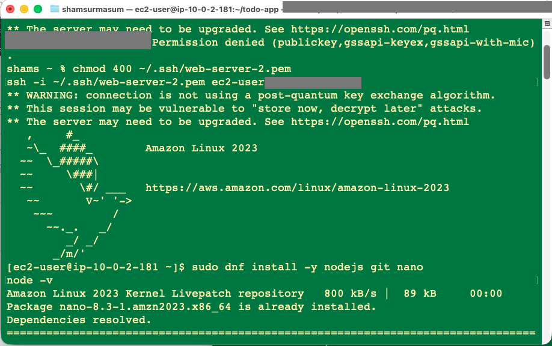

### SSH: Operation timed out

**Symptom:**

```
ssh: connect to host 100.53.68.144 port 22: Operation timed out
```

**Cause:** the SSH rule in `ToDoApp-Webserver-SG` allows only the IP you had when you created it (`/32`). Your public IP changed: a different Wi-Fi network, a VPN turning on or off, or your internet provider assigning a new address.

**Diagnose** from your machine:

```bash
curl -4 -s https://checkip.amazonaws.com      # your current public IP
nc -vz -G 5 <instance-public-ip> 22           # times out if blocked
```

If the IP doesn't match the SSH rule's source, that's the cause.

**Fix:** **EC2 → Security Groups → `ToDoApp-Webserver-SG` → Edit inbound rules**. On the SSH rule, choose **Source → My IP** again, then **Save rules**.

**Alternative:** use **Session Manager**, which needs no open port or key. Select the instance, choose **Connect → Session Manager → Connect**, then run `sudo su - ec2-user`. This requires the [IAM role](#instance-launched-without-the-iam-role).

Other causes of an SSH timeout: the instance has no public IP, the subnet's route table has no `0.0.0.0/0 → IGW` route, or the instance is stopped.

**Related prompt (harmless):** `override r-------- ... for ~/.ssh/web-server-1.pem? (y/n)` appears when `mv` replaces a key that's already read-only (`chmod 400`). Answer `y`.

---

## Database

### Can't find the RDS networking details

**Symptom:** the **Connectivity & security** tab has no **Networking** section (VPC, subnet group, publicly accessible). It only shows connection snippets, connected compute resources and security group rules.

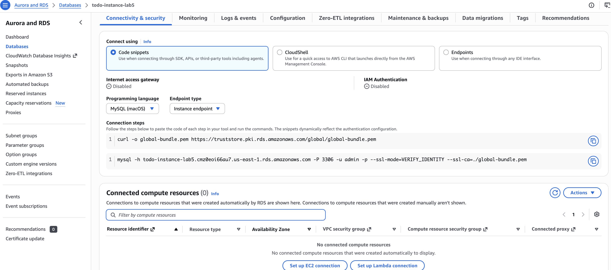

**Cause:** AWS redesigned the RDS console.

**Fix:** find each detail elsewhere:

| Detail | Where to find it |
|---|---|
| VPC, Multi-AZ | **Databases** list (scroll right) |
| Subnet group and its subnets | Sidebar → **Subnet groups** → pick the one in your VPC |
| Engine version | Database → **Configuration** tab |
| Publicly accessible | **Configuration** tab, or **Modify → Connectivity → Additional configuration** (then **Cancel**) |
| Endpoint | **Connectivity & security → Connection steps** snippet |

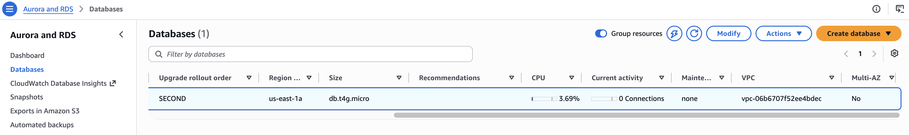

You can also check whether the database is public, and which subnet it's in, by resolving its endpoint:

```bash
dig +short <db-endpoint> @8.8.8.8
```

A `10.0.x.x` address means it isn't publicly accessible. The third number shows the subnet: in the Run 2 layout, `10.0.3.x` is Private-A and `10.0.4.x` is Private-B. In Run 2 the database is in us-east-1a, so Private-A.

### RDS subnet group includes public subnets

**Symptom:** the DB's subnet group is `default-vpc-<id>` and lists all four subnets.

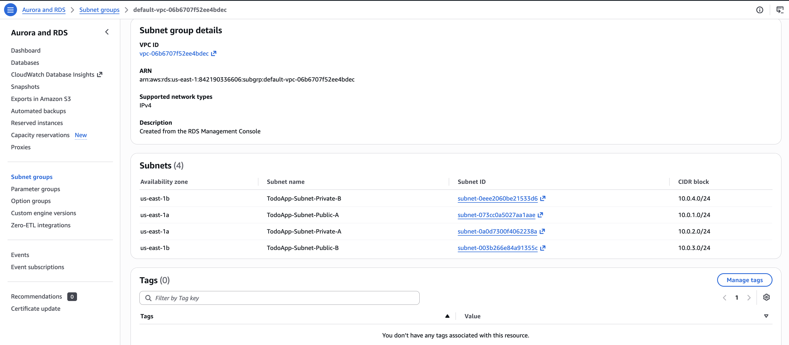

**Cause:** when you create a database without choosing a subnet group, the console auto-creates one with **every** subnet in the VPC. RDS can then put the DB, or a future standby or restore, in a public subnet.

This happened in Run 1, so the CIDRs below are the Run 1 layout, where the private subnets were `10.0.2.0/24` and `10.0.4.0/24`. In Run 2, the custom subnet group `todoapp-db-subnet-group` was created first, with only `10.0.3.0/24` and `10.0.4.0/24`. See [setup-rds.md](setup-rds.md).

**Check where the DB actually is:** `dig +short <db-endpoint> @8.8.8.8` returned `10.0.2.246`, so it's in Private-A. That makes it safe to edit the group.

**Fix:** **Subnet groups → select the group → Edit**. Uncheck `10.0.1.0/24` and `10.0.3.0/24` (the public subnets) and keep `10.0.2.0/24` and `10.0.4.0/24`. Click **Save**. This doesn't restart the database.

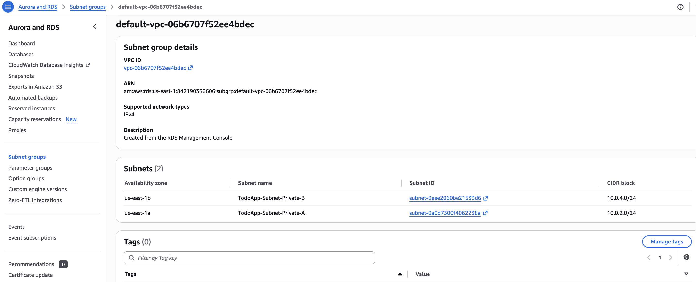

If the DB is already **in** a public subnet, you can't remove that subnet from its group. Because this DB is empty, the simplest fix is to delete it and recreate it with a subnet group containing only the private subnets.

### Schema file and MySQL client not on the instance

**Symptom:** `db/schema.sql` or `.env.example` is missing after `git clone`, or `mysql` reports `command not found`.

**Cause (Run 1):** the GitHub repo had only the app code (`index.js`, `public/`, `package.json`). The schema and docs were written locally and hadn't been pushed. In Run 2 the app comes from [masumshamsur/Project-ToDoApp](https://github.com/masumshamsur/Project-ToDoApp), which includes `db/schema.sql` and `.env.example`. Amazon Linux 2023 doesn't include a MySQL client. Its `mariadb105` package can also fail against MySQL 8.4 users that use `caching_sha2_password`.

**Fix:** create the schema with the app's own `mysql2` driver. See [setup-ec2.md → 3.6](setup-ec2.md#36-create-the-schema-one-instance-only). Create `.env` with the heredoc in [setup-ec2.md → 3.4](setup-ec2.md#34-create-env).

### `/tasks` returns "Could not fetch tasks" (Run 2)

**Symptom:** after filling in `.env` and restarting the app, the database connection test passed (`CONNECTED { version: '8.4.11' }`), but the API failed on both servers:

```
$ curl -s localhost:3000/tasks
{"error":"Could not fetch tasks"}
$ curl -s -X POST localhost:3000/tasks ...
{"error":"Could not create task"}
```

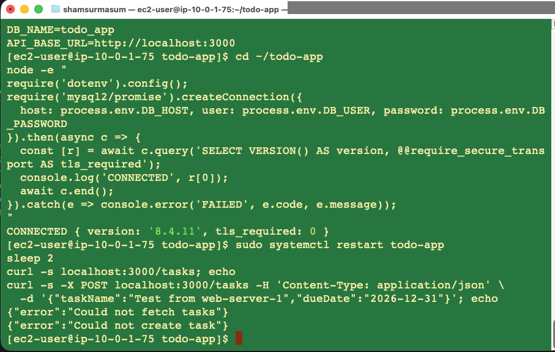

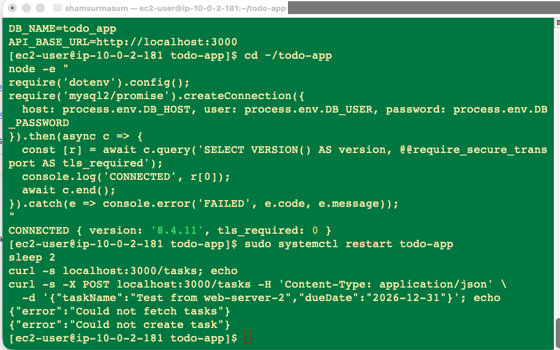

**Diagnosis:** the app returns only a generic message to the client and logs the real error. Read the log:

```bash
sudo journalctl -u todo-app -n 20 --no-pager
```

```
Error creating task: Error: Table 'todo_app.Tasks' doesn't exist
  code: 'ER_NO_SUCH_TABLE',
  errno: 1146,
  sql: 'INSERT INTO Tasks (task_name, task_description, due_date) VALUES (?, ?, ?)',
  sqlMessage: "Table 'todo_app.Tasks' doesn't exist"
```

**Cause:** the table-creation step ([setup-ec2.md → 3.6](setup-ec2.md#36-create-the-schema-one-instance-only)) was skipped. The connection test only logs in to MySQL and doesn't touch any table, so it passes even when the table is missing. The `todo_app` database itself existed, because it was set as the initial database name when creating RDS. Otherwise the error would be `ER_BAD_DB_ERROR` (`Unknown database 'todo_app'`).

**Fix:** run the schema script from 4.3 on **one** server. It creates the database if needed and the `Tasks` table. You don't need to restart the app, because it queries the database on every request.

After the fix, `GET /tasks` returns `[]`, then the test task is created:

![After creating the table: TABLE READY, GET /tasks returns [], POST creates taskId 1](images/r2-22-schema-and-tasks-ws1.png)

### RDS requires TLS

**Symptom:** the connection test prints `tls_required: 1`, or the app fails with `HANDSHAKE_SSL_REQUIRED` or a "secure transport required" error.

**Status in this deployment:** not needed. The test returned `tls_required: 0` on MySQL 8.4.11.

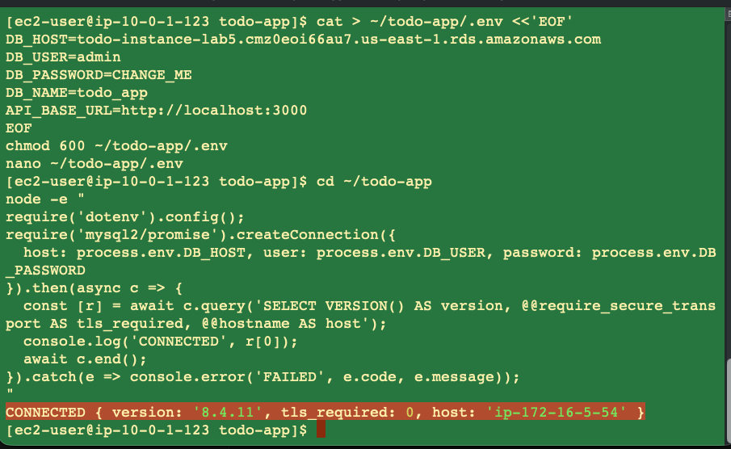

**Fix if you need it:** `mysql2` ships AWS's RDS certificates, so in `index.js` add `ssl` to the pool options:

```js
const db = mysql.createPool({
  host: process.env.DB_HOST,
  user: process.env.DB_USER,
  password: process.env.DB_PASSWORD,
  database: process.env.DB_NAME,
  ssl: 'Amazon RDS',
});
```

---

## EC2

### Instance launched without the IAM role

**Symptom:** the instance's **IAM role** field shows `–`, and **Connect → Session Manager** is unavailable.

**Fix:** select the instance, then **Actions → Security → Modify IAM role → `TodoApp-EC2-Role` → Update IAM role**. No restart is needed. Check the instance's **Security** tab.

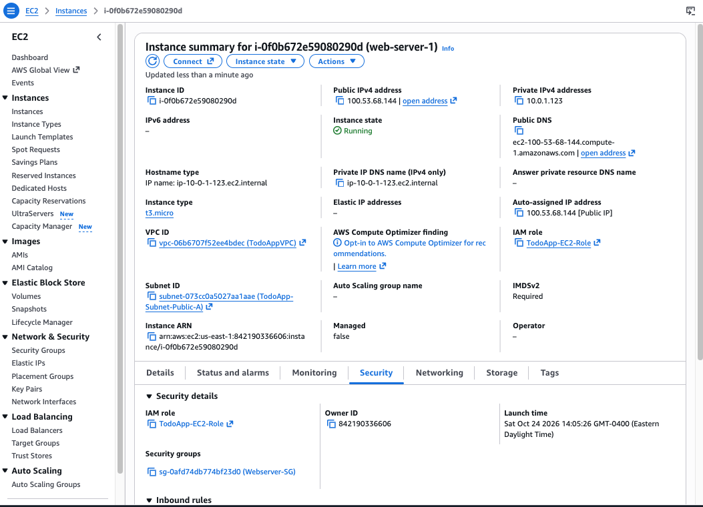

Session Manager can take up to 30 minutes to recognise the new role. To speed it up, run `sudo systemctl restart amazon-ssm-agent` over SSH, or reboot the instance.

### Extra instance not in the architecture

**Symptom:** a `Bastion-connect` instance was running next to the two web servers.

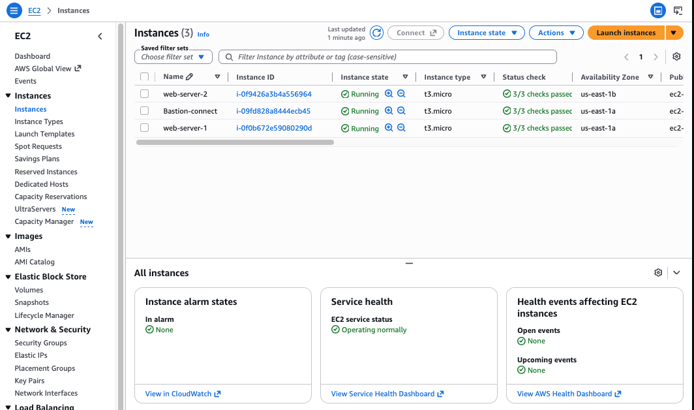

**Fix:** the web servers are in public subnets with SSH limited to your IP (plus Session Manager), so a bastion isn't needed. Terminate it with **Instance state → Terminate (delete) instance**, so you aren't charged for it.

### Harmless messages in the terminal

| Message | Meaning |
|---|---|
| `WARNING: connection is not using a post-quantum key exchange algorithm` | Your Mac's newer OpenSSH client noticing that the server is older. The connection is still encrypted. |
| `A newer release of "Amazon Linux" is available` | Optional OS update (`sudo dnf upgrade --releasever=<version>`). |
| `^[[200~` / `^[[201~` and `$'\E[200~cd': command not found` | Bracketed-paste markers leaking into the shell when pasting several lines. Run the affected command again. The rest of the paste runs normally. |

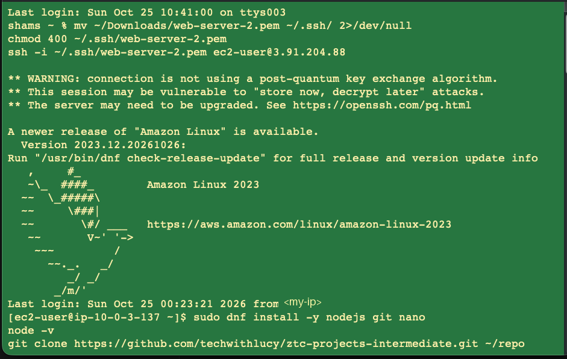

---

## Load balancer and app

### ALB "Reachability may be impacted": no outbound rule (Run 2)

**Symptom:** right after `TodoApp-ALB` was created, a **⚠ Reachability may be impacted** warning appeared next to its name. The tooltip says "Misconfigured security group rules. View the Security tab."

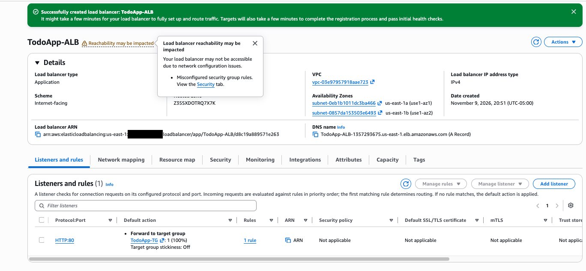

The **Security** tab shows the cause. `ToDoApp-ALB-SG` has **1** inbound rule but **0 outbound rules**: "Your security groups must include at least 1 inbound rule and at least 1 outbound rule for your load balancer to receive internet traffic and send traffic to targets."

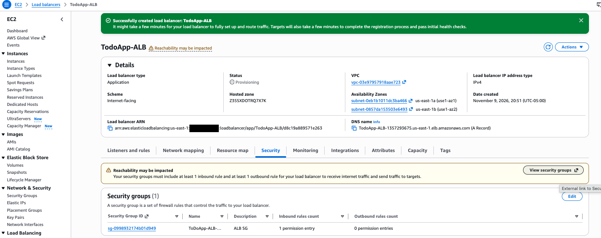

**Cause:** the ALB group's default outbound rule ("All traffic → `0.0.0.0/0`") had been deleted, probably while removing the stray SSH rule in Step 1.

The inbound side was fine, so browsers could still reach the ALB. But the ALB **starts its own connections** to the web servers on port `3000`, both to forward each request and to run health checks. Outbound rules control connections a resource starts, so all of these were blocked. Left like this, both targets would turn **Unhealthy**, and the browser would get **502 Bad Gateway** or **504 Gateway Timeout**.

**Fix:** **EC2 → Security Groups → `ToDoApp-ALB-SG` → Outbound rules → Edit outbound rules → Add rule**:

| Type | Port | Destination type | Destination |
|---|---|---|---|
| Custom TCP | `3000` | **Custom** | `ToDoApp-Webserver-SG` (`sg-0d06e3270610cb1c5`) |

Choose **Save rules**.

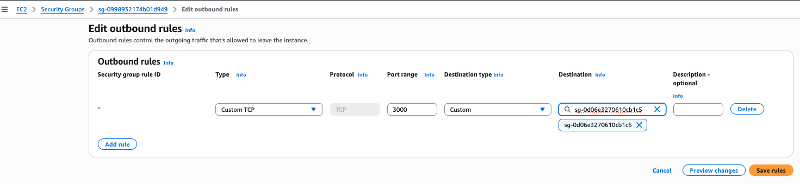

At first the destination was left as **Anywhere-IPv4** (`0.0.0.0/0`). That works, but the console warns about it, and it lets the ALB send to any address on port 3000. Pointing the rule at `ToDoApp-Webserver-SG` mirrors the web servers' inbound rule (3000 from `ToDoApp-ALB-SG`), so the ALB can reach only the web servers. See [setup-network.md → How the rules fit together](setup-network.md#how-the-rules-fit-together).

After saving, the warning disappears once the ALB is **Active**, and the targets turn **Healthy**.

**Rule of thumb:** security groups are stateful, so you only allow the side that **starts** a connection. Replies are always allowed back. The ALB starts connections to the targets, so its group needs an **outbound** rule to them, and the web servers' group needs the matching **inbound** rule.

### Register targets lists no instances (Run 2)

**Symptom:** while registering targets for `TodoApp-TG`, **Available instances** showed **(0)** and "No instances", although both web servers were running.

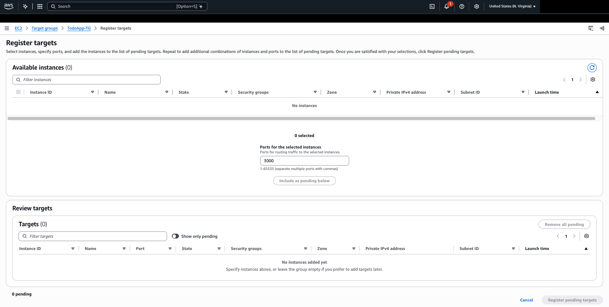

**Cause in Run 2:** the list just hadn't loaded. The target group was already in `TodoAppVPC` and both instances were running.

**Fix:** refresh. Reloading the page, or using the refresh button ↻ on the **Available instances** panel, listed both servers. They were then registered on port `3000`.

**If refreshing doesn't help:** this list only shows **running** instances in the **same VPC as the target group**, in the current Region. Check, in this order:

1. **Target groups → TodoApp-TG → Details → VPC** must be `TodoAppVPC` (`vpc-03e97957918aae723`). The VPC dropdown in **Create target group** defaults to the **default VPC**, and a target group's VPC can't be changed later. If it's wrong, delete the target group and create it again with **VPC → `TodoAppVPC`**.
2. Both instances must be **Running**. Stopped instances aren't listed.
3. The console Region must be **N. Virginia** (`us-east-1`).

### Target group shows targets as Unused

**Symptom:** right after you create `TodoApp-TG`, both targets show **Unused** ("Target group is not configured to receive traffic from the load balancer").

**Fix:** none needed. Health checks only start once a load balancer listener forwards to the target group. Create the ALB, and within about 30 seconds of it becoming **Active** both targets turn **Healthy**.

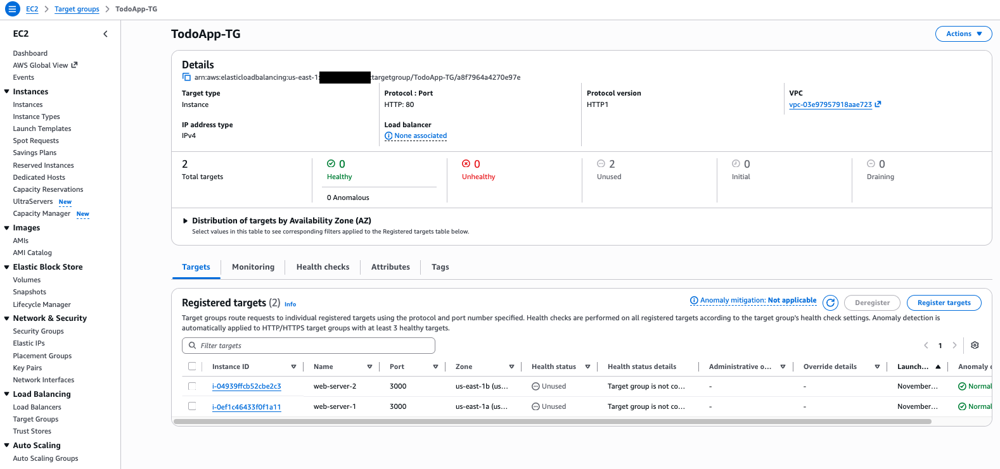

If targets become **Unhealthy** after the ALB exists:

- `ToDoApp-Webserver-SG` must allow TCP **3000** from `ToDoApp-ALB-SG`.
- `ToDoApp-ALB-SG` must have an outbound rule to TCP **3000** (see [above](#alb-reachability-may-be-impacted-no-outbound-rule-run-2)).
- The app must be running: `sudo systemctl status todo-app`.
- The target port must be **3000**, and the health check path `/` must return 200: `curl -s -o /dev/null -w '%{http_code}\n' localhost:3000/`.

### Page loads but the list is empty and Add Task does nothing

**Symptom:** `http://<alb-dns-name>` shows the To-Do page, but no tasks appear, even though the database has some, and clicking **Add Task** does nothing.

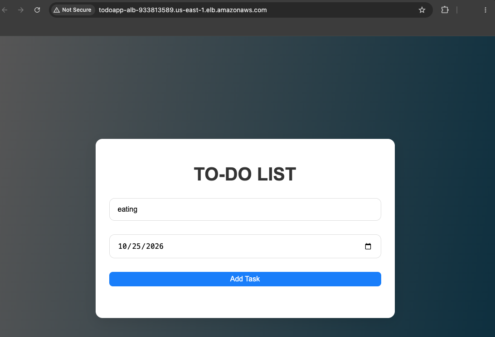

**Cause:** the frontend asks `/config` where the API is. `API_BASE_URL` was still `http://localhost:3000`, so the browser sent its API calls to **your own computer**, which has nothing on port 3000. The requests failed silently. The errors only show in the browser's **Console**.

**Diagnose** from your machine:

```bash
curl -s http://<alb-dns-name>/config     # {"API_BASE_URL":"http://localhost:3000"} = wrong
curl -s http://<alb-dns-name>/tasks      # tasks returned = API and DB are fine
```

Run `/config` several times. The ALB alternates between servers, and **both** must return the ALB URL.

**Fix:** on **both** instances, update `.env` and **restart**, because the app only reads `.env` at startup:

```bash
cd ~/todo-app
sed -i 's|^API_BASE_URL=.*|API_BASE_URL=http://<alb-dns-name>|' .env
sudo systemctl restart todo-app
```

Then hard-refresh the browser (**Cmd+Shift+R**).

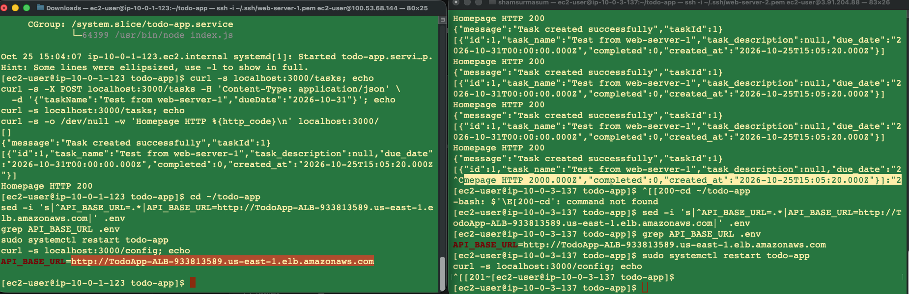

### `curl /config` prints nothing after a restart

**Symptom:** `sudo systemctl restart todo-app && curl -s localhost:3000/config` prints an empty line.

**Cause:** `curl` ran before Node.js was listening again, and `-s` hides the "connection refused" error.

**Fix:** wait a moment first: `sleep 2; curl -s localhost:3000/config`.

### Due dates show one day early

**Symptom:** a task created with due date `2026-12-31` shows as **12/30/2026** in the browser.

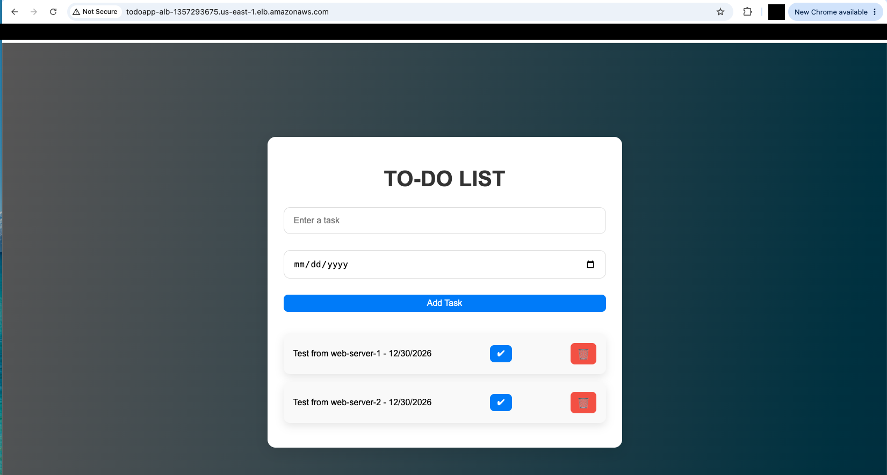

**Cause:** an app bug, not an infrastructure problem. The database stores the right date.

1. The `due_date` column is a MySQL `DATE`, with no time or time zone.
2. The `mysql2` driver turns it into a JavaScript `Date` at **midnight UTC**, so the API returns `"due_date":"2026-12-31T00:00:00.000Z"`.
3. `public/script.js` formats it with `new Date(task.due_date).toLocaleDateString()`, which converts to the browser's local time. In US Eastern (UTC-5) that's **7 PM on Dec 30**.

**Fix (optional, in the app code):** format the date in UTC. In `public/script.js`:

```js
const formattedDate = task.due_date
  ? new Date(task.due_date).toLocaleDateString(undefined, { timeZone: 'UTC' })
  : 'No due date';
```

Commit it, then run `cd ~/todo-app && git pull` on both servers and hard-refresh the browser. No restart is needed, because `script.js` is a static file. This build left it unfixed, as a known issue.

---

## Other common problems

| Symptom | Cause / fix |
|---|---|
| `GET /tasks` returns `500` | The app can't reach the DB. Check `.env`, and that `ToDoApp-Database-SG` allows `3306` from `ToDoApp-Webserver-SG`. Run `journalctl -u todo-app -n 30 --no-pager`. |
| `ER_NO_SUCH_TABLE` in the logs | The schema hasn't been created, or `DB_NAME` doesn't match. Run [setup-ec2.md → 3.6](setup-ec2.md#36-create-the-schema-one-instance-only). |
| `ER_ACCESS_DENIED_ERROR` | Wrong `DB_USER` or `DB_PASSWORD`. To reset the password: RDS → **Modify → New master password → Apply immediately**. |
| `ETIMEDOUT` connecting to RDS | Security group rule missing, or the DB is in a different VPC. |
| ALB returns `502` / `503` | No healthy targets. See [Target group shows targets as Unused](#target-group-shows-targets-as-unused). |
| ALB URL times out | `ToDoApp-ALB-SG` is missing inbound HTTP 80, the ALB is in the private subnets, or you used `https://` (there's no 443 listener). |
| `todo-app` service keeps restarting | Run `journalctl -u todo-app -n 50 --no-pager`. Usually `.env` is missing or `npm install` wasn't run. |
| `Permission denied (publickey)` | Wrong key file or user. Use the key pair shown on the instance's **Details** tab, and user `ec2-user`. |
| `UNPROTECTED PRIVATE KEY FILE!` | Run `chmod 400 ~/.ssh/<key>.pem`. |

## Useful diagnostic commands

On an instance:

```bash
sudo systemctl status todo-app --no-pager     # is the app running?
journalctl -u todo-app -n 50 --no-pager       # app logs
curl -s localhost:3000/config; echo           # what the frontend will use
curl -s localhost:3000/tasks; echo            # API + DB check
grep -v PASSWORD ~/todo-app/.env              # config without the password
```

From your machine:

```bash
curl -4 -s https://checkip.amazonaws.com                 # your public IP (for the SSH rule)
dig +short <db-endpoint> @8.8.8.8                        # RDS private IP -> which subnet
for i in 1 2 3 4; do curl -s http://<alb-dns-name>/config; echo; done   # both targets
curl -s http://<alb-dns-name>/tasks                      # end-to-end through the ALB
```
